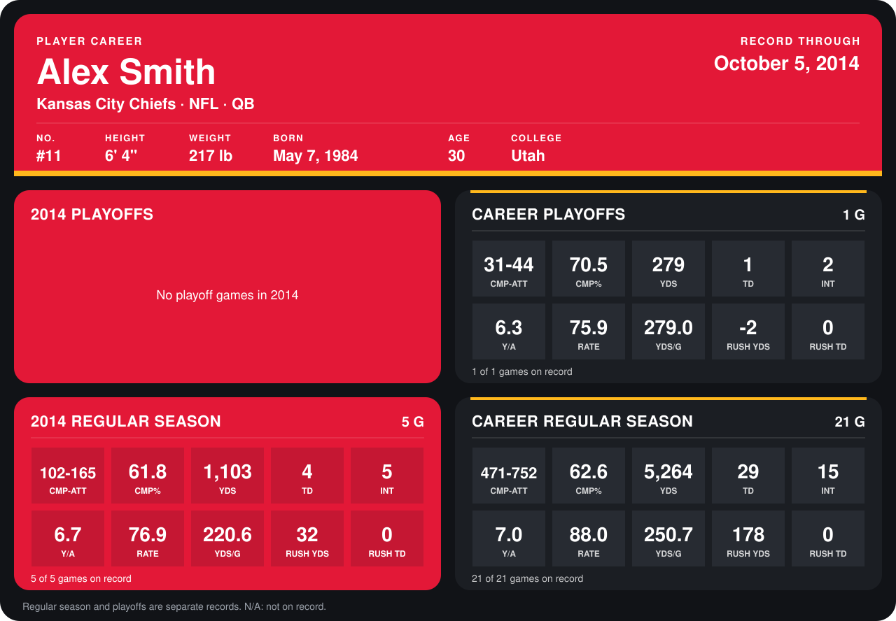

# Alex Smith

## Career stats

### Regular season

| Season | Team | Age | # | G | CMP-ATT | CMP% | YDS | TD | INT | Y/A | RATE | YDS/G | RUSH YDS | RUSH TD |
|---|---|---:|---:|---:|---:|---:|---:|---:|---:|---:|---:|---:|---:|---:|
| 2013 | Kansas City Chiefs | 29 | 11 | 16 | 369-587 | 62.9 | 4,161 | 25 | 10 | 7.1 | 91.1 | 260.1 | 146 | 0 |
| 2014 | Kansas City Chiefs | 30 | 11 | 4 | 75-130 | 57.7 | 778 | 2 | 4 | 6.0 | 67.4 | 194.5 | 17 | 0 |
| **Career** |  |  |  | 20 | 444-717 | 61.9 | 4,939 | 27 | 14 | 6.9 | 86.8 | 246.9 | 163 | 0 |

### Playoffs

| Season | Team | Age | # | G | CMP-ATT | CMP% | YDS | TD | INT | Y/A | RATE | YDS/G | RUSH YDS | RUSH TD |
|---|---|---:|---:|---:|---:|---:|---:|---:|---:|---:|---:|---:|---:|---:|
| 2013 | Kansas City Chiefs | 29 | 11 | 1 | 31-44 | 70.5 | 279 | 1 | 2 | 6.3 | 75.9 | 279.0 | -2 | 0 |
| **Career** |  |  |  | 1 | 31-44 | 70.5 | 279 | 1 | 2 | 6.3 | 75.9 | 279.0 | -2 | 0 |

## Awards

- Pro Bowl selection, replacement (2013, QB)

Age is his age on the league's opening game of each season; # is the number listed for him that season with that team (2014: the card's rule; 2013: the 2013 season roster), N/A where no listing applies.

Records through September 29, 2014. Identity: listed 2014 roster data, Weeks 1-4; number: 2014 Week 1 roster. [All Kansas City Chiefs players](README.md).
