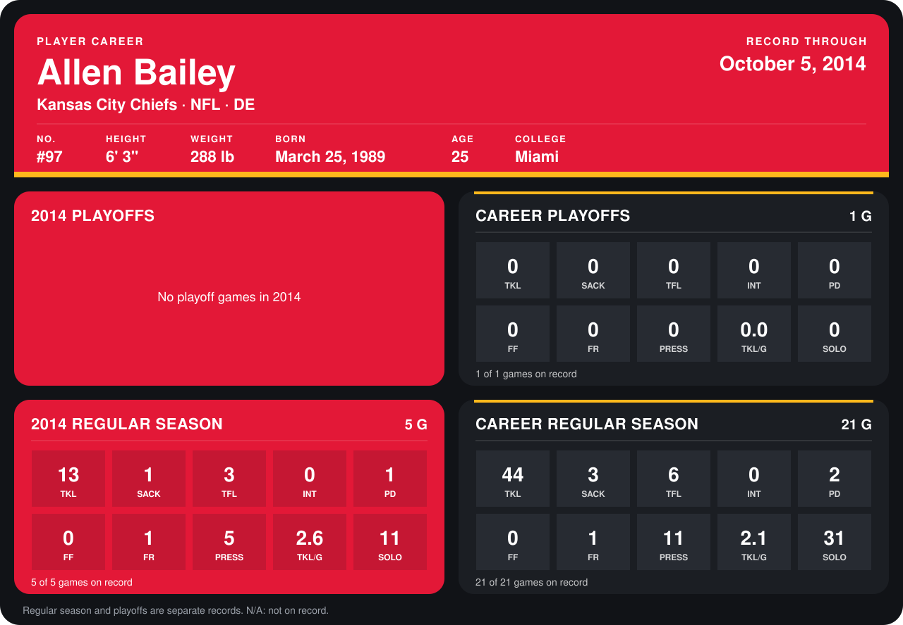

# Allen Bailey

## Career stats

### Regular season

| Season | Club | G | TKL | SACK | TFL | INT | PD | FF | FR | PRESS | TKL/G | SOLO |
|---|---|---:|---:|---:|---:|---:|---:|---:|---:|---:|---:|---:|
| 2013 | Kansas City Chiefs | 16 | 31 | 2 | 3 | 0 | 1 | 0 | 0 | 6 | 1.9 | 20 |
| 2014 | Kansas City Chiefs | 5 | 13 | 1 | 3 | 0 | 1 | 0 | 1 | 5 | 2.6 | 11 |
| **Career** |  | 21 | 44 | 3 | 6 | 0 | 2 | 0 | 1 | 11 | 2.1 | 31 |

### Playoffs

| Season | Club | G | TKL | SACK | TFL | INT | PD | FF | FR | PRESS | TKL/G | SOLO |
|---|---|---:|---:|---:|---:|---:|---:|---:|---:|---:|---:|---:|
| 2013 | Kansas City Chiefs | 1 | 0 | 0 | 0 | 0 | 0 | 0 | 0 | 0 | 0.0 | 0 |
| **Career** |  | 1 | 0 | 0 | 0 | 0 | 0 | 0 | 0 | 0 | 0.0 | 0 |

## Awards

None on record.

Records through October 5, 2014. Identity: listed 2014 roster data, Weeks 1-4; number: 2014 Week 1 roster. [All Kansas City Chiefs players](README.md).
