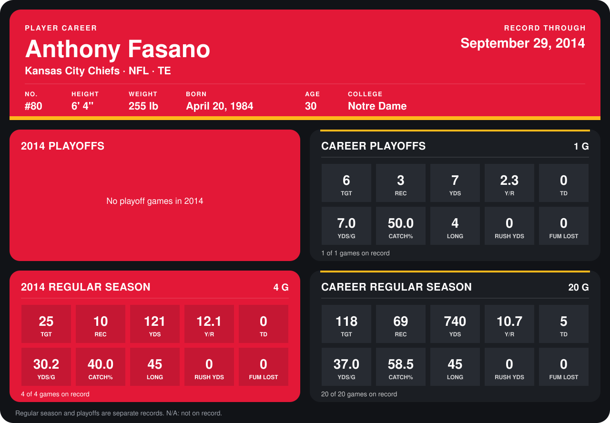

# Anthony Fasano

## Career stats

### Regular season

| Season | Team | Age | # | G | TGT | REC | YDS | Y/R | TD | YDS/G | CATCH% | LONG | RUSH YDS | FUM LOST |
|---|---|---:|---:|---:|---:|---:|---:|---:|---:|---:|---:|---:|---:|---:|
| 2013 | Kansas City Chiefs | 29 | 80 | 16 | 93 | 59 | 619 | 10.5 | 5 | 38.7 | 63.4 | 43 | 0 | 0 |
| 2014 | Kansas City Chiefs | 30 | 80 | 5 | 28 | 13 | 163 | 12.5 | 0 | 32.6 | 46.4 | 45 | 0 | 0 |
| **Career** |  |  |  | 21 | 121 | 72 | 782 | 10.9 | 5 | 37.2 | 59.5 | 45 | 0 | 0 |

### Playoffs

| Season | Team | Age | # | G | TGT | REC | YDS | Y/R | TD | YDS/G | CATCH% | LONG | RUSH YDS | FUM LOST |
|---|---|---:|---:|---:|---:|---:|---:|---:|---:|---:|---:|---:|---:|---:|
| 2013 | Kansas City Chiefs | 29 | 80 | 1 | 6 | 3 | 7 | 2.3 | 0 | 7.0 | 50.0 | 4 | 0 | 0 |
| **Career** |  |  |  | 1 | 6 | 3 | 7 | 2.3 | 0 | 7.0 | 50.0 | 4 | 0 | 0 |

## Awards

None on record.

Age is his age on the league's opening game of each season; # is the number listed for him that season with that team (2014: the card's rule; 2013: the 2013 season roster), N/A where no listing applies.

Records through October 5, 2014. Identity: listed 2014 roster data, Weeks 1-4; number: 2014 Week 1 roster. [All Kansas City Chiefs players](README.md).
