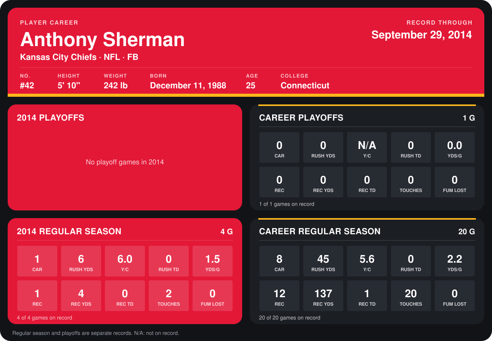

# Anthony Sherman

## Career stats

### Regular season

| Season | Team | Age | # | G | CAR | RUSH YDS | Y/C | RUSH TD | YDS/G | REC | REC YDS | REC TD | TOUCHES | FUM LOST |
|---|---|---:|---:|---:|---:|---:|---:|---:|---:|---:|---:|---:|---:|---:|
| 2013 | Kansas City Chiefs | 24 | 42 | 16 | 7 | 39 | 5.6 | 0 | 2.4 | 11 | 133 | 1 | 18 | 0 |
| 2014 | Kansas City Chiefs | 25 | 42 | 5 | 2 | 5 | 2.5 | 0 | 1.0 | 1 | 4 | 0 | 3 | 0 |
| **Career** |  |  |  | 21 | 9 | 44 | 4.9 | 0 | 2.1 | 12 | 137 | 1 | 21 | 0 |

### Playoffs

| Season | Team | Age | # | G | CAR | RUSH YDS | Y/C | RUSH TD | YDS/G | REC | REC YDS | REC TD | TOUCHES | FUM LOST |
|---|---|---:|---:|---:|---:|---:|---:|---:|---:|---:|---:|---:|---:|---:|
| 2013 | Kansas City Chiefs | 24 | 42 | 1 | 0 | 0 | N/A | 0 | 0.0 | 0 | 0 | 0 | 0 | 0 |
| **Career** |  |  |  | 1 | 0 | 0 | N/A | 0 | 0.0 | 0 | 0 | 0 | 0 | 0 |

## Awards

None on record.

Age is his age on the league's opening game of each season; # is the number listed for him that season with that team (2014: the card's rule; 2013: the 2013 season roster), N/A where no listing applies.

Records through October 5, 2014. Identity: listed 2014 roster data, Weeks 1-4; number: 2014 Week 1 roster. [All Kansas City Chiefs players](README.md).
