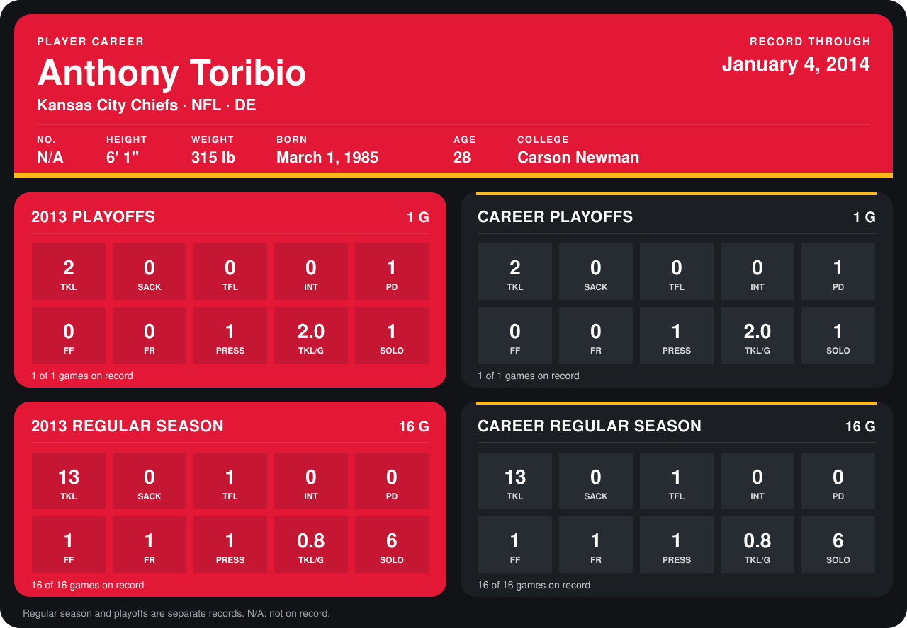

# Anthony Toribio

## Career stats

### Regular season

| Season | Club | G | TKL | SACK | TFL | INT | PD | FF | FR | PRESS | TKL/G | SOLO |
|---|---|---:|---:|---:|---:|---:|---:|---:|---:|---:|---:|---:|
| 2013 | Kansas City Chiefs | 16 | 13 | 0 | 1 | 0 | 0 | 1 | 1 | 1 | 0.8 | 6 |
| **Career** |  | 16 | 13 | 0 | 1 | 0 | 0 | 1 | 1 | 1 | 0.8 | 6 |

### Playoffs

| Season | Club | G | TKL | SACK | TFL | INT | PD | FF | FR | PRESS | TKL/G | SOLO |
|---|---|---:|---:|---:|---:|---:|---:|---:|---:|---:|---:|---:|
| 2013 | Kansas City Chiefs | 1 | 2 | 0 | 0 | 0 | 1 | 0 | 0 | 1 | 2.0 | 1 |
| **Career** |  | 1 | 2 | 0 | 0 | 0 | 1 | 0 | 0 | 1 | 2.0 | 1 |

## Awards

None on record.

Records through January 4, 2014. Identity: his listed 2013 season roster data (no 2014 Weeks 1-4 roster row). [All Kansas City Chiefs players](README.md).
