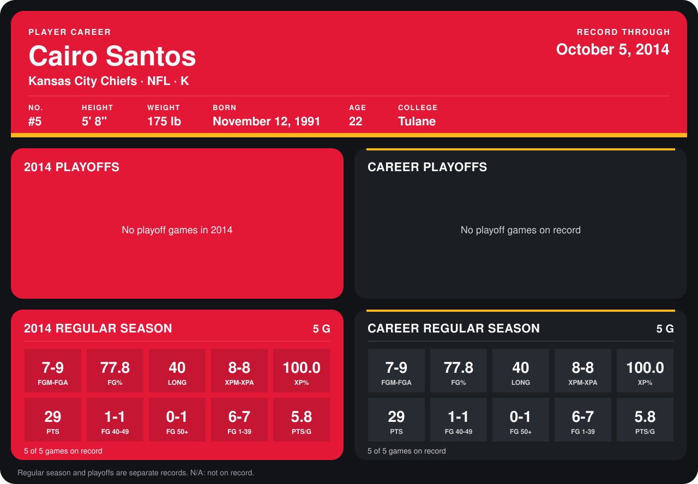

# Cairo Santos

## Career stats

### Regular season

| Season | Club | G | FGM-FGA | FG% | LONG | XPM-XPA | XP% | PTS | FG 40-49 | FG 50+ | FG 1-39 | PTS/G |
|---|---|---:|---:|---:|---:|---:|---:|---:|---:|---:|---:|---:|
| 2014 | Kansas City Chiefs | 4 | 5-6 | 83.3 | 40 | 4-4 | 100.0 | 19 | 1-1 | 0-1 | 4-4 | 4.8 |
| **Career** |  | 4 | 5-6 | 83.3 | 40 | 4-4 | 100.0 | 19 | 1-1 | 0-1 | 4-4 | 4.8 |

### Playoffs

No playoff games on record.

## Awards

None on record.

Records through September 29, 2014. Identity: listed 2014 roster data, Weeks 1-4; number: 2014 Week 1 roster. [All Kansas City Chiefs players](README.md).
