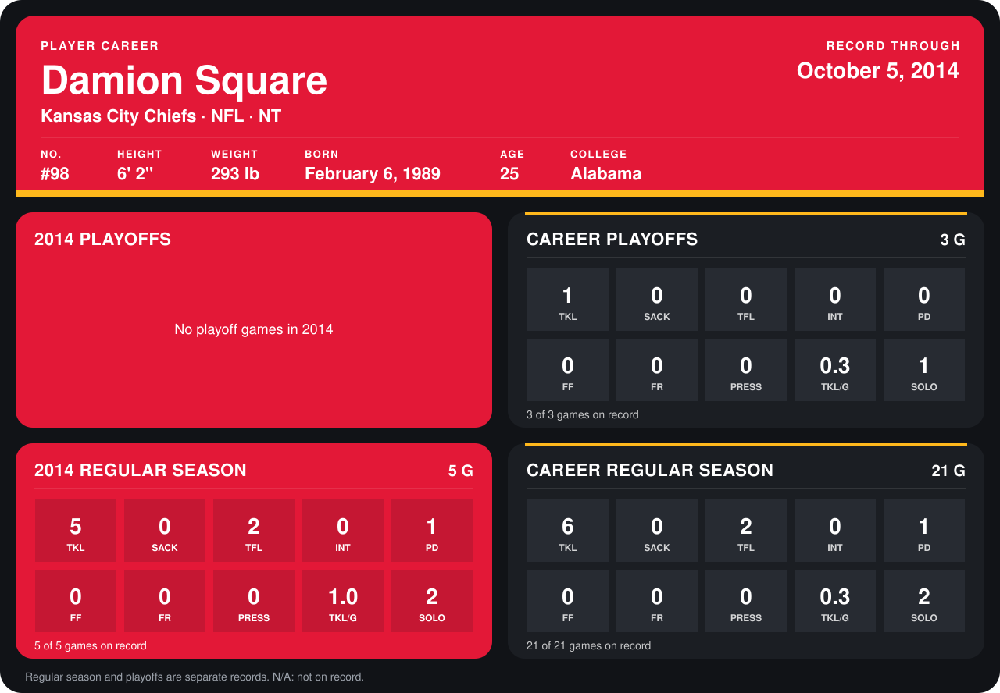

# Damion Square

## Career stats

### Regular season

| Season | Team | Age | # | G | TKL | SACK | TFL | INT | PD | FF | FR | PRESS | TKL/G | SOLO |
|---|---|---:|---:|---:|---:|---:|---:|---:|---:|---:|---:|---:|---:|---:|
| 2013 | Philadelphia Eagles | 24 | 77 | 16 | 1 | 0 | 0 | 0 | 0 | 0 | 0 | 0 | 0.1 | 0 |
| 2014 | Kansas City Chiefs | 25 | 98 | 5 | 5 | 0 | 2 | 0 | 1 | 0 | 0 | 0 | 1.0 | 2 |
| **Career** |  |  |  | 21 | 6 | 0 | 2 | 0 | 1 | 0 | 0 | 0 | 0.3 | 2 |

### Playoffs

| Season | Team | Age | # | G | TKL | SACK | TFL | INT | PD | FF | FR | PRESS | TKL/G | SOLO |
|---|---|---:|---:|---:|---:|---:|---:|---:|---:|---:|---:|---:|---:|---:|
| 2013 | Philadelphia Eagles | 24 | 77 | 3 | 1 | 0 | 0 | 0 | 0 | 0 | 0 | 0 | 0.3 | 1 |
| **Career** |  |  |  | 3 | 1 | 0 | 0 | 0 | 0 | 0 | 0 | 0 | 0.3 | 1 |

## Awards

None on record.

Age is his age on the league's opening game of each season; # is the number listed for him that season with that team (2014: the card's rule; 2013: the 2013 season roster), N/A where no listing applies.

Records through October 5, 2014. Identity: listed 2014 roster data, Weeks 1-4; number: 2014 Week 1 roster. [All Kansas City Chiefs players](README.md).
