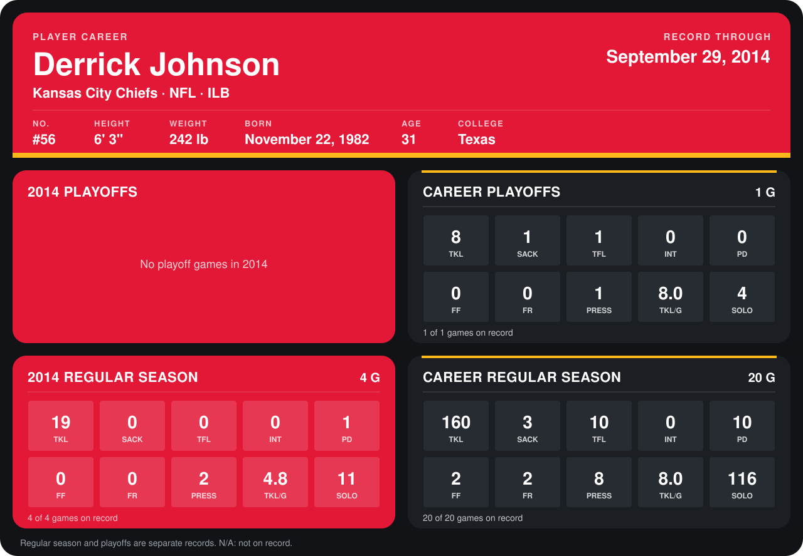

# Derrick Johnson

## Career stats

### Regular season

| Season | Club | G | TKL | SACK | TFL | INT | PD | FF | FR | PRESS | TKL/G | SOLO |
|---|---|---:|---:|---:|---:|---:|---:|---:|---:|---:|---:|---:|
| 2013 | Kansas City Chiefs | 16 | 141 | 3 | 10 | 0 | 9 | 2 | 2 | 6 | 8.8 | 105 |
| 2014 | Kansas City Chiefs | 4 | 19 | 0 | 0 | 0 | 1 | 0 | 0 | 2 | 4.8 | 11 |
| **Career** |  | 20 | 160 | 3 | 10 | 0 | 10 | 2 | 2 | 8 | 8.0 | 116 |

### Playoffs

| Season | Club | G | TKL | SACK | TFL | INT | PD | FF | FR | PRESS | TKL/G | SOLO |
|---|---|---:|---:|---:|---:|---:|---:|---:|---:|---:|---:|---:|
| 2013 | Kansas City Chiefs | 1 | 8 | 1 | 1 | 0 | 0 | 0 | 0 | 1 | 8.0 | 4 |
| **Career** |  | 1 | 8 | 1 | 1 | 0 | 0 | 0 | 0 | 1 | 8.0 | 4 |

## Awards

- AFC Defensive Player of the Week (2013, Week 12)

Records through September 29, 2014. Identity: listed 2014 roster data, Weeks 1-4; number: 2014 Week 1 roster. [All Kansas City Chiefs players](README.md).
