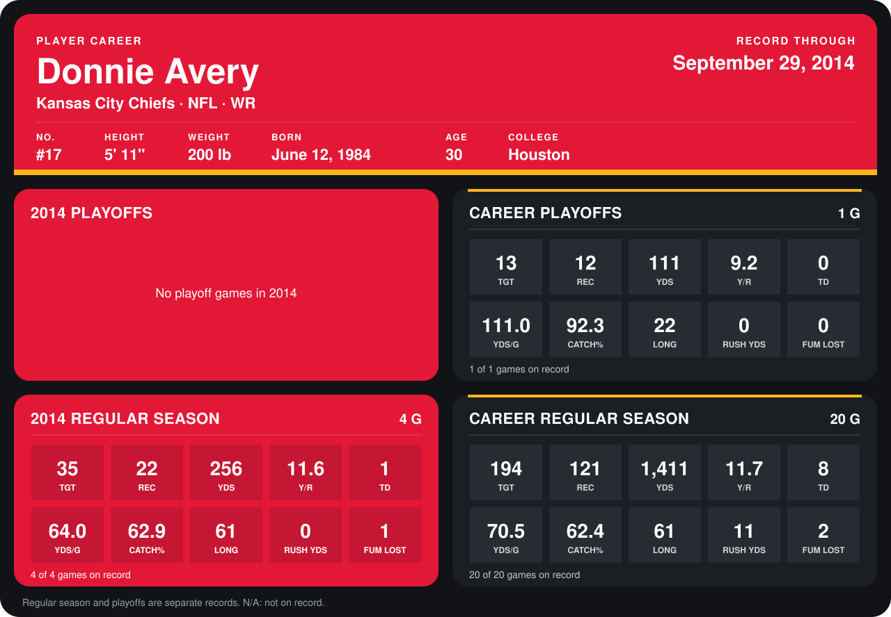

# Donnie Avery

## Career stats

### Regular season

| Season | Club | G | TGT | REC | YDS | Y/R | TD | YDS/G | CATCH% | LONG | RUSH YDS | FUM LOST |
|---|---|---:|---:|---:|---:|---:|---:|---:|---:|---:|---:|---:|
| 2013 | Kansas City Chiefs | 16 | 159 | 99 | 1,155 | 11.7 | 7 | 72.2 | 62.3 | 58 | 11 | 1 |
| 2014 | Kansas City Chiefs | 5 | 42 | 29 | 366 | 12.6 | 1 | 73.2 | 69.0 | 61 | 0 | 1 |
| **Career** |  | 21 | 201 | 128 | 1,521 | 11.9 | 8 | 72.4 | 63.7 | 61 | 11 | 2 |

### Playoffs

| Season | Club | G | TGT | REC | YDS | Y/R | TD | YDS/G | CATCH% | LONG | RUSH YDS | FUM LOST |
|---|---|---:|---:|---:|---:|---:|---:|---:|---:|---:|---:|---:|
| 2013 | Kansas City Chiefs | 1 | 13 | 12 | 111 | 9.2 | 0 | 111.0 | 92.3 | 22 | 0 | 0 |
| **Career** |  | 1 | 13 | 12 | 111 | 9.2 | 0 | 111.0 | 92.3 | 22 | 0 | 0 |

## Awards

None on record.

Records through October 5, 2014. Identity: listed 2014 roster data, Weeks 1-4; number: 2014 Week 1 roster. [All Kansas City Chiefs players](README.md).
