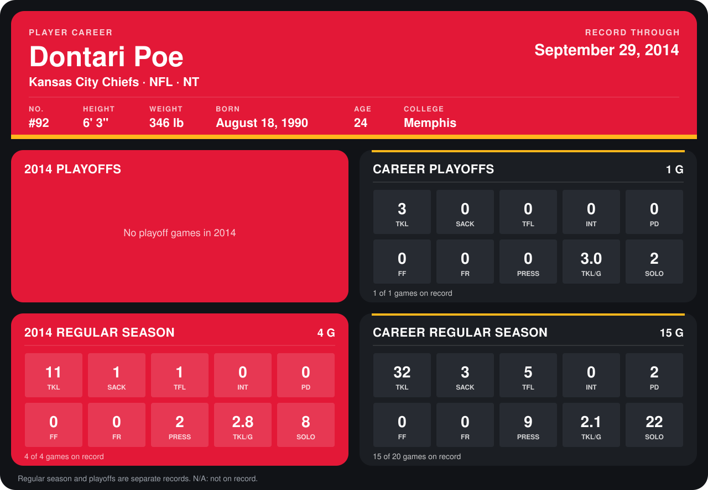

# Dontari Poe

## Career stats

### Regular season

| Season | Club | G | TKL | SACK | TFL | INT | PD | FF | FR | PRESS | TKL/G | SOLO |
|---|---|---:|---:|---:|---:|---:|---:|---:|---:|---:|---:|---:|
| 2013 | Kansas City Chiefs | 11 | 21 | 2 | 4 | 0 | 2 | 0 | 0 | 7 | 1.9 | 14 |
| 2014 | Kansas City Chiefs | 5 | 11 | 1 | 1 | 0 | 0 | 0 | 0 | 2 | 2.2 | 8 |
| **Career** |  | 16 | 32 | 3 | 5 | 0 | 2 | 0 | 0 | 9 | 2.0 | 22 |

### Playoffs

| Season | Club | G | TKL | SACK | TFL | INT | PD | FF | FR | PRESS | TKL/G | SOLO |
|---|---|---:|---:|---:|---:|---:|---:|---:|---:|---:|---:|---:|
| 2013 | Kansas City Chiefs | 1 | 3 | 0 | 0 | 0 | 0 | 0 | 0 | 0 | 3.0 | 2 |
| **Career** |  | 1 | 3 | 0 | 0 | 0 | 0 | 0 | 0 | 0 | 3.0 | 2 |

## Awards

None on record.

Records through October 5, 2014. Identity: listed 2014 roster data, Weeks 1-4; number: 2014 Week 1 roster. [All Kansas City Chiefs players](README.md).
