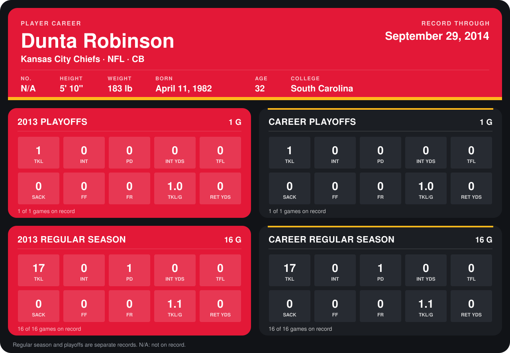

# Dunta Robinson

## Career stats

### Regular season

| Season | Team | Age | # | G | TKL | INT | PD | INT YDS | TFL | SACK | FF | FR | TKL/G | RET YDS |
|---|---|---:|---:|---:|---:|---:|---:|---:|---:|---:|---:|---:|---:|---:|
| 2013 | Kansas City Chiefs | 31 | 21 | 16 | 17 | 0 | 1 | 0 | 0 | 0 | 0 | 0 | 1.1 | 0 |
| **Career** |  |  |  | 16 | 17 | 0 | 1 | 0 | 0 | 0 | 0 | 0 | 1.1 | 0 |

### Playoffs

| Season | Team | Age | # | G | TKL | INT | PD | INT YDS | TFL | SACK | FF | FR | TKL/G | RET YDS |
|---|---|---:|---:|---:|---:|---:|---:|---:|---:|---:|---:|---:|---:|---:|
| 2013 | Kansas City Chiefs | 31 | 21 | 1 | 1 | 0 | 0 | 0 | 0 | 0 | 0 | 0 | 1.0 | 0 |
| **Career** |  |  |  | 1 | 1 | 0 | 0 | 0 | 0 | 0 | 0 | 0 | 1.0 | 0 |

## Awards

None on record.

Age is his age on the league's opening game of each season; # is the number listed for him that season with that team (2014: the card's rule; 2013: the 2013 season roster), N/A where no listing applies.

Records through January 4, 2014. Identity: his listed 2013 season roster data (no 2014 Weeks 1-4 roster row). [All Kansas City Chiefs players](README.md).
