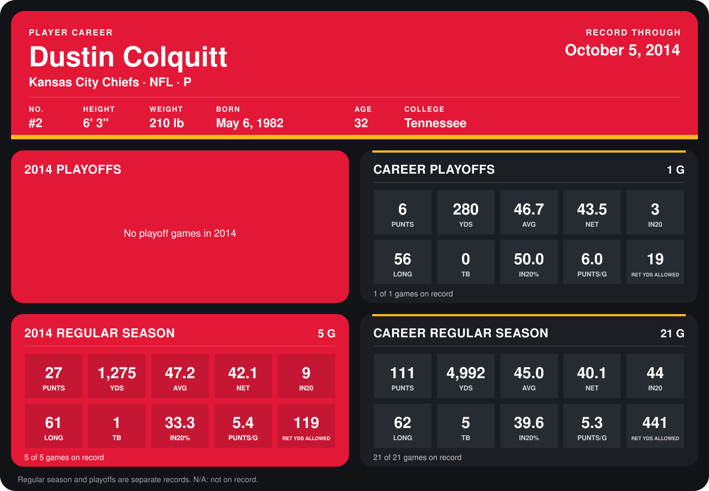

# Dustin Colquitt

## Career stats

### Regular season

| Season | Team | Age | # | G | PUNTS | YDS | AVG | NET | IN20 | LONG | TB | IN20% | PUNTS/G | RET YDS ALLOWED |
|---|---|---:|---:|---:|---:|---:|---:|---:|---:|---:|---:|---:|---:|---:|
| 2013 | Kansas City Chiefs | 31 | 2 | 16 | 84 | 3,717 | 44.2 | 39.5 | 35 | 62 | 4 | 41.7 | 5.2 | 322 |
| 2014 | Kansas City Chiefs | 32 | 2 | 5 | 27 | 1,275 | 47.2 | 42.1 | 9 | 61 | 1 | 33.3 | 5.4 | 119 |
| **Career** |  |  |  | 21 | 111 | 4,992 | 45.0 | 40.1 | 44 | 62 | 5 | 39.6 | 5.3 | 441 |

### Playoffs

| Season | Team | Age | # | G | PUNTS | YDS | AVG | NET | IN20 | LONG | TB | IN20% | PUNTS/G | RET YDS ALLOWED |
|---|---|---:|---:|---:|---:|---:|---:|---:|---:|---:|---:|---:|---:|---:|
| 2013 | Kansas City Chiefs | 31 | 2 | 1 | 6 | 280 | 46.7 | 43.5 | 3 | 56 | 0 | 50.0 | 6.0 | 19 |
| **Career** |  |  |  | 1 | 6 | 280 | 46.7 | 43.5 | 3 | 56 | 0 | 50.0 | 6.0 | 19 |

## Awards

- AFC Special Teams Player of the Week (2014, Week 3)

Age is his age on the league's opening game of each season; # is the number listed for him that season with that team (2014: the card's rule; 2013: the 2013 season roster), N/A where no listing applies.

Records through October 5, 2014. Identity: listed 2014 roster data, Weeks 1-4; number: 2014 Week 1 roster. [All Kansas City Chiefs players](README.md).
