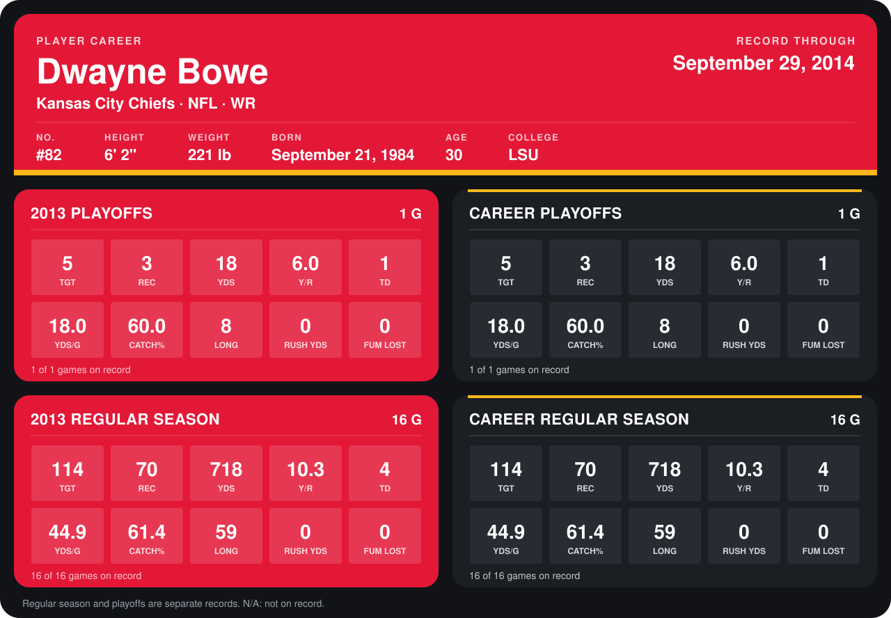

# Dwayne Bowe

## Career stats

### Regular season

| Season | Club | G | TGT | REC | YDS | Y/R | TD | YDS/G | CATCH% | LONG | RUSH YDS | FUM LOST |
|---|---|---:|---:|---:|---:|---:|---:|---:|---:|---:|---:|---:|
| 2013 | Kansas City Chiefs | 16 | 114 | 70 | 718 | 10.3 | 4 | 44.9 | 61.4 | 59 | 0 | 0 |
| 2014 | Kansas City Chiefs | 1 | 0 | 0 | 0 | N/A | 0 | 0.0 | N/A | N/A | 0 | 0 |
| **Career** |  | 17 | 114 | 70 | 718 | 10.3 | 4 | 42.2 | 61.4 | 59 | 0 | 0 |

### Playoffs

| Season | Club | G | TGT | REC | YDS | Y/R | TD | YDS/G | CATCH% | LONG | RUSH YDS | FUM LOST |
|---|---|---:|---:|---:|---:|---:|---:|---:|---:|---:|---:|---:|
| 2013 | Kansas City Chiefs | 1 | 5 | 3 | 18 | 6.0 | 1 | 18.0 | 60.0 | 8 | 0 | 0 |
| **Career** |  | 1 | 5 | 3 | 18 | 6.0 | 1 | 18.0 | 60.0 | 8 | 0 | 0 |

## Awards

None on record.

Records through October 5, 2014. Identity: listed 2014 roster data, Weeks 1-4; number: 2014 Week 4 roster listing. [All Kansas City Chiefs players](README.md).
