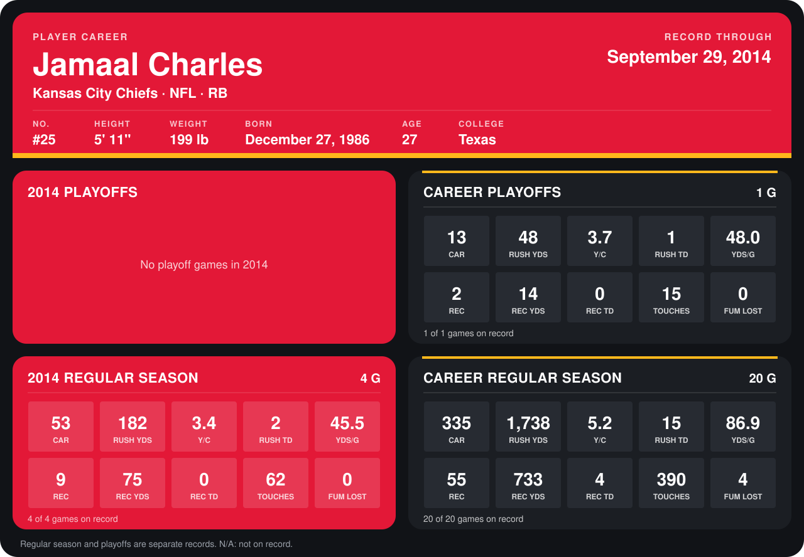

# Jamaal Charles

## Career stats

### Regular season

| Season | Club | G | CAR | RUSH YDS | Y/C | RUSH TD | YDS/G | REC | REC YDS | REC TD | TOUCHES | FUM LOST |
|---|---|---:|---:|---:|---:|---:|---:|---:|---:|---:|---:|---:|
| 2013 | Kansas City Chiefs | 16 | 282 | 1,556 | 5.5 | 13 | 97.2 | 46 | 658 | 4 | 328 | 4 |
| 2014 | Kansas City Chiefs | 5 | 79 | 336 | 4.3 | 4 | 67.2 | 13 | 108 | 1 | 92 | 0 |
| **Career** |  | 21 | 361 | 1,892 | 5.2 | 17 | 90.1 | 59 | 766 | 5 | 420 | 4 |

### Playoffs

| Season | Club | G | CAR | RUSH YDS | Y/C | RUSH TD | YDS/G | REC | REC YDS | REC TD | TOUCHES | FUM LOST |
|---|---|---:|---:|---:|---:|---:|---:|---:|---:|---:|---:|---:|
| 2013 | Kansas City Chiefs | 1 | 13 | 48 | 3.7 | 1 | 48.0 | 2 | 14 | 0 | 15 | 0 |
| **Career** |  | 1 | 13 | 48 | 3.7 | 1 | 48.0 | 2 | 14 | 0 | 15 | 0 |

## Awards

- AFC Offensive Player of the Week (2013, Week 7)
- AFC Offensive Player of the Month (2013, October)
- AP Most Valuable Player (2013)
- AP First-Team All-Pro (2013, RB)
- Pro Bowl selection (2013, RB)

Records through October 5, 2014. Identity: listed 2014 roster data, Weeks 1-4; number: 2014 Week 1 roster. [All Kansas City Chiefs players](README.md).
