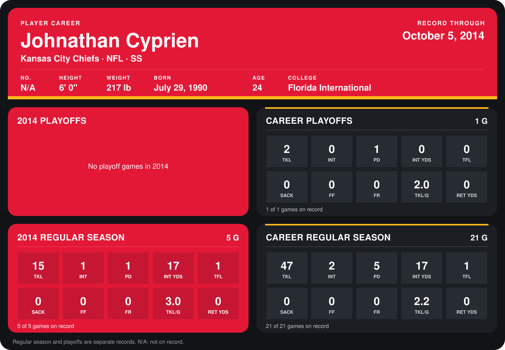

# Johnathan Cyprien

## Career stats

### Regular season

| Season | Team | Age | # | G | TKL | INT | PD | INT YDS | TFL | SACK | FF | FR | TKL/G | RET YDS |
|---|---|---:|---:|---:|---:|---:|---:|---:|---:|---:|---:|---:|---:|---:|
| 2013 | Kansas City Chiefs | 23 | N/A | 16 | 32 | 1 | 4 | 0 | 0 | 0 | 0 | 0 | 2.0 | 0 |
| 2014 | Kansas City Chiefs | 24 | N/A | 4 | 14 | 1 | 1 | 17 | 1 | 0 | 0 | 0 | 3.5 | 0 |
| **Career** |  |  |  | 20 | 46 | 2 | 5 | 17 | 1 | 0 | 0 | 0 | 2.3 | 0 |

### Playoffs

| Season | Team | Age | # | G | TKL | INT | PD | INT YDS | TFL | SACK | FF | FR | TKL/G | RET YDS |
|---|---|---:|---:|---:|---:|---:|---:|---:|---:|---:|---:|---:|---:|---:|
| 2013 | Kansas City Chiefs | 23 | N/A | 1 | 2 | 0 | 1 | 0 | 0 | 0 | 0 | 0 | 2.0 | 0 |
| **Career** |  |  |  | 1 | 2 | 0 | 1 | 0 | 0 | 0 | 0 | 0 | 2.0 | 0 |

## Awards

None on record.

Age is his age on the league's opening game of each season; # is the number listed for him that season with that team (2014: the card's rule; 2013: the 2013 season roster), N/A where no listing applies.

Records through September 29, 2014. Identity: listed 2014 roster data, Weeks 1-4. [All Kansas City Chiefs players](README.md).
