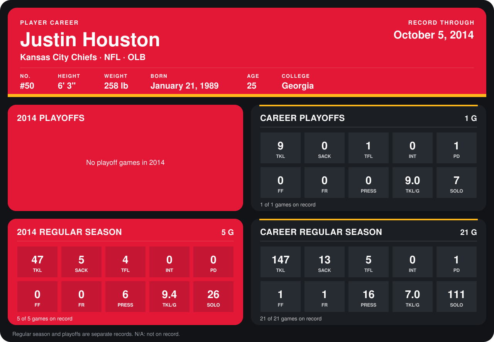

# Justin Houston

## Career stats

### Regular season

| Season | Team | Age | # | G | TKL | SACK | TFL | INT | PD | FF | FR | PRESS | TKL/G | SOLO |
|---|---|---:|---:|---:|---:|---:|---:|---:|---:|---:|---:|---:|---:|---:|
| 2013 | Kansas City Chiefs | 24 | 50 | 16 | 100 | 8 | 1 | 0 | 1 | 1 | 1 | 10 | 6.2 | 85 |
| 2014 | Kansas City Chiefs | 25 | 50 | 5 | 47 | 5 | 4 | 0 | 0 | 0 | 0 | 6 | 9.4 | 26 |
| **Career** |  |  |  | 21 | 147 | 13 | 5 | 0 | 1 | 1 | 1 | 16 | 7.0 | 111 |

### Playoffs

| Season | Team | Age | # | G | TKL | SACK | TFL | INT | PD | FF | FR | PRESS | TKL/G | SOLO |
|---|---|---:|---:|---:|---:|---:|---:|---:|---:|---:|---:|---:|---:|---:|
| 2013 | Kansas City Chiefs | 24 | 50 | 1 | 9 | 0 | 1 | 0 | 1 | 0 | 0 | 0 | 9.0 | 7 |
| **Career** |  |  |  | 1 | 9 | 0 | 1 | 0 | 1 | 0 | 0 | 0 | 9.0 | 7 |

## Awards

None on record.

Age is his age on the league's opening game of each season; # is the number listed for him that season with that team (2014: the card's rule; 2013: the 2013 season roster), N/A where no listing applies.

Records through October 5, 2014. Identity: listed 2014 roster data, Weeks 1-4; number: 2014 Week 1 roster. [All Kansas City Chiefs players](README.md).
