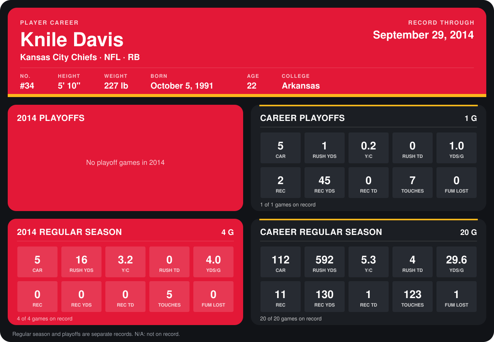

# Knile Davis

## Career stats

### Regular season

| Season | Team | Age | # | G | CAR | RUSH YDS | Y/C | RUSH TD | YDS/G | REC | REC YDS | REC TD | TOUCHES | FUM LOST |
|---|---|---:|---:|---:|---:|---:|---:|---:|---:|---:|---:|---:|---:|---:|
| 2013 | Kansas City Chiefs | 21 | 34 | 16 | 107 | 576 | 5.4 | 4 | 36.0 | 11 | 130 | 1 | 118 | 1 |
| 2014 | Kansas City Chiefs | 22 | 34 | 4 | 5 | 16 | 3.2 | 0 | 4.0 | 0 | 0 | 0 | 5 | 0 |
| **Career** |  |  |  | 20 | 112 | 592 | 5.3 | 4 | 29.6 | 11 | 130 | 1 | 123 | 1 |

### Playoffs

| Season | Team | Age | # | G | CAR | RUSH YDS | Y/C | RUSH TD | YDS/G | REC | REC YDS | REC TD | TOUCHES | FUM LOST |
|---|---|---:|---:|---:|---:|---:|---:|---:|---:|---:|---:|---:|---:|---:|
| 2013 | Kansas City Chiefs | 21 | 34 | 1 | 5 | 1 | 0.2 | 0 | 1.0 | 2 | 45 | 0 | 7 | 0 |
| **Career** |  |  |  | 1 | 5 | 1 | 0.2 | 0 | 1.0 | 2 | 45 | 0 | 7 | 0 |

## Awards

None on record.

Age is his age on the league's opening game of each season; # is the number listed for him that season with that team (2014: the card's rule; 2013: the 2013 season roster), N/A where no listing applies.

Records through September 29, 2014. Identity: listed 2014 roster data, Weeks 1-4; number: 2014 Week 1 roster. [All Kansas City Chiefs players](README.md).
