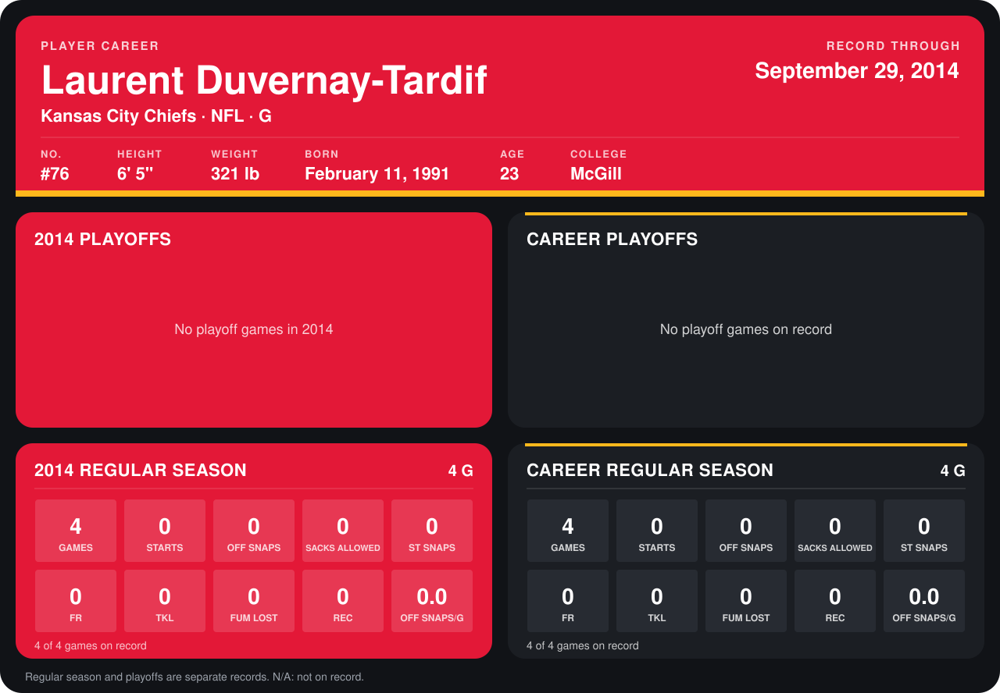

# Laurent Duvernay-Tardif

## Career stats

### Regular season

| Season | Club | G | STARTS | OFF SNAPS | SACKS ALLOWED | ST SNAPS | FR | TKL | FUM LOST | REC | OFF SNAPS/G |
|---|---|---:|---:|---:|---:|---:|---:|---:|---:|---:|---:|
| 2014 | Kansas City Chiefs | 4 | 0 | 0 | 0 | 0 | 0 | 0 | 0 | 0 | 0.0 |
| **Career** |  | 4 | 0 | 0 | 0 | 0 | 0 | 0 | 0 | 0 | 0.0 |

### Playoffs

No playoff games on record.

## Awards

None on record.

Records through October 5, 2014. Identity: listed 2014 roster data, Weeks 1-4; number: 2014 Week 1 roster. [All Kansas City Chiefs players](README.md).
