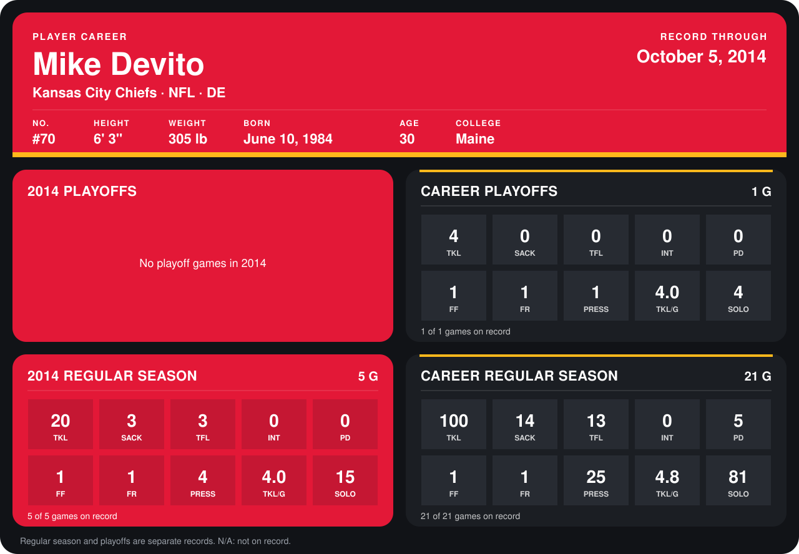

# Mike Devito

## Career stats

### Regular season

| Season | Club | G | TKL | SACK | TFL | INT | PD | FF | FR | PRESS | TKL/G | SOLO |
|---|---|---:|---:|---:|---:|---:|---:|---:|---:|---:|---:|---:|
| 2013 | Kansas City Chiefs | 16 | 80 | 11 | 10 | 0 | 5 | 0 | 0 | 21 | 5.0 | 66 |
| 2014 | Kansas City Chiefs | 5 | 20 | 3 | 3 | 0 | 0 | 1 | 1 | 4 | 4.0 | 15 |
| **Career** |  | 21 | 100 | 14 | 13 | 0 | 5 | 1 | 1 | 25 | 4.8 | 81 |

### Playoffs

| Season | Club | G | TKL | SACK | TFL | INT | PD | FF | FR | PRESS | TKL/G | SOLO |
|---|---|---:|---:|---:|---:|---:|---:|---:|---:|---:|---:|---:|
| 2013 | Kansas City Chiefs | 1 | 4 | 0 | 0 | 0 | 0 | 1 | 1 | 1 | 4.0 | 4 |
| **Career** |  | 1 | 4 | 0 | 0 | 0 | 0 | 1 | 1 | 1 | 4.0 | 4 |

## Awards

- AFC Defensive Player of the Week (2013, Week 8)
- Pro Bowl selection (2013, DE)

Records through October 5, 2014. Identity: listed 2014 roster data, Weeks 1-4; number: 2014 Week 1 roster. [All Kansas City Chiefs players](README.md).
