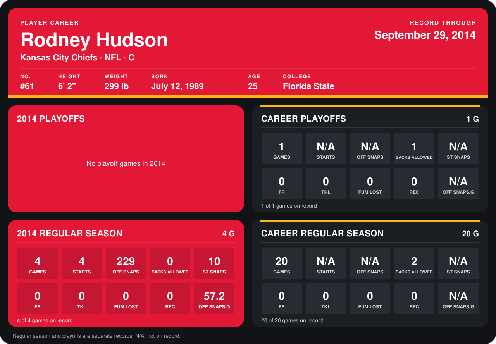

# Rodney Hudson

## Career stats

### Regular season

| Season | Team | Age | # | G | STARTS | OFF SNAPS | SACKS ALLOWED | ST SNAPS | FR | TKL | FUM LOST | REC | OFF SNAPS/G |
|---|---|---:|---:|---:|---:|---:|---:|---:|---:|---:|---:|---:|---:|
| 2013 | Kansas City Chiefs | 24 | 61 | 16 | N/A | N/A | 2 | N/A | 0 | 0 | 0 | 0 | N/A |
| 2014 | Kansas City Chiefs | 25 | 61 | 4 | 4 | 229 | 0 | 10 | 0 | 0 | 0 | 0 | 57.2 |
| **Career** |  |  |  | 20 | N/A | N/A | 2 | N/A | 0 | 0 | 0 | 0 | N/A |

### Playoffs

| Season | Team | Age | # | G | STARTS | OFF SNAPS | SACKS ALLOWED | ST SNAPS | FR | TKL | FUM LOST | REC | OFF SNAPS/G |
|---|---|---:|---:|---:|---:|---:|---:|---:|---:|---:|---:|---:|---:|
| 2013 | Kansas City Chiefs | 24 | 61 | 1 | N/A | N/A | 1 | N/A | 0 | 0 | 0 | 0 | N/A |
| **Career** |  |  |  | 1 | N/A | N/A | 1 | N/A | 0 | 0 | 0 | 0 | N/A |

## Awards

- AP Second-Team All-Pro (2013, C)
- Pro Bowl selection (2013, C)

Age is his age on the league's opening game of each season; # is the number listed for him that season with that team (2014: the card's rule; 2013: the 2013 season roster), N/A where no listing applies.

Records through September 29, 2014. Identity: listed 2014 roster data, Weeks 1-4; number: 2014 Week 1 roster. [All Kansas City Chiefs players](README.md).
