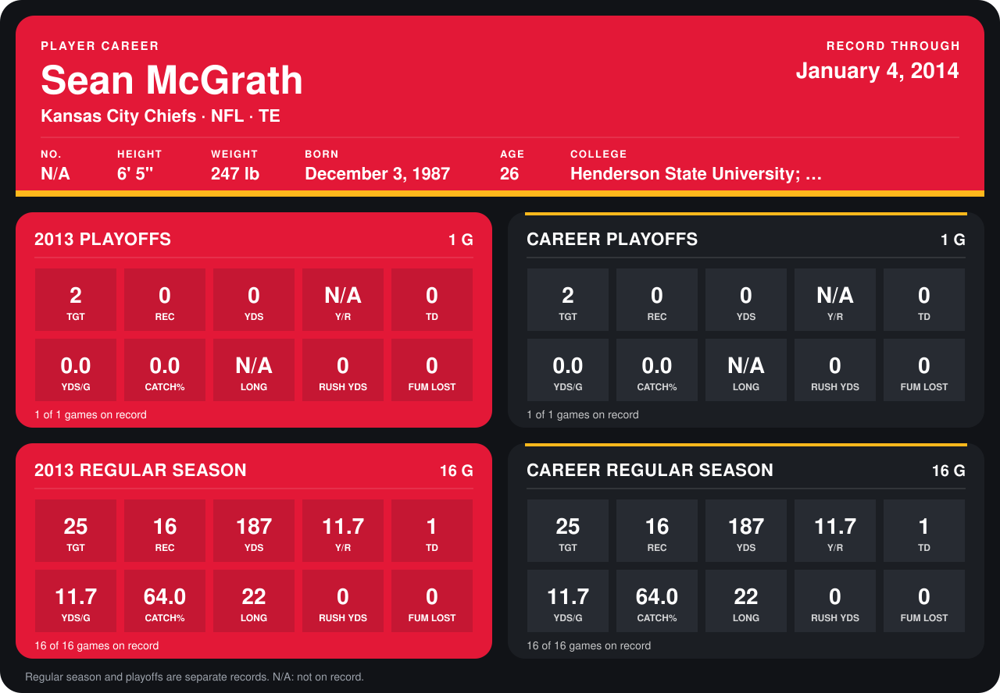

# Sean McGrath

## Career stats

### Regular season

| Season | Club | G | TGT | REC | YDS | Y/R | TD | YDS/G | CATCH% | LONG | RUSH YDS | FUM LOST |
|---|---|---:|---:|---:|---:|---:|---:|---:|---:|---:|---:|---:|
| 2013 | Kansas City Chiefs | 16 | 25 | 16 | 187 | 11.7 | 1 | 11.7 | 64.0 | 22 | 0 | 0 |
| **Career** |  | 16 | 25 | 16 | 187 | 11.7 | 1 | 11.7 | 64.0 | 22 | 0 | 0 |

### Playoffs

| Season | Club | G | TGT | REC | YDS | Y/R | TD | YDS/G | CATCH% | LONG | RUSH YDS | FUM LOST |
|---|---|---:|---:|---:|---:|---:|---:|---:|---:|---:|---:|---:|
| 2013 | Kansas City Chiefs | 1 | 2 | 0 | 0 | N/A | 0 | 0.0 | 0.0 | N/A | 0 | 0 |
| **Career** |  | 1 | 2 | 0 | 0 | N/A | 0 | 0.0 | 0.0 | N/A | 0 | 0 |

## Awards

None on record.

Records through September 29, 2014. Identity: the public player file's latest listing (no 2014 Weeks 1-4 roster row). [All Kansas City Chiefs players](README.md).
