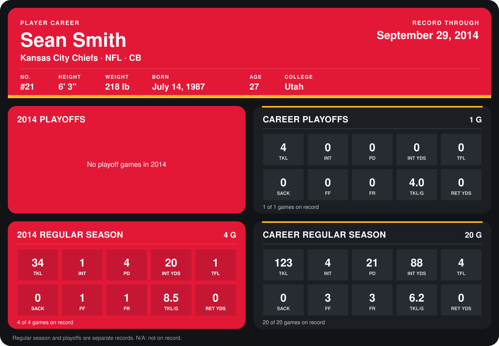

# Sean Smith

## Career stats

### Regular season

| Season | Club | G | TKL | INT | PD | INT YDS | TFL | SACK | FF | FR | TKL/G | RET YDS |
|---|---|---:|---:|---:|---:|---:|---:|---:|---:|---:|---:|---:|
| 2013 | Kansas City Chiefs | 16 | 89 | 3 | 17 | 68 | 3 | 0 | 2 | 2 | 5.6 | 0 |
| 2014 | Kansas City Chiefs | 5 | 38 | 1 | 7 | 20 | 1 | 0 | 1 | 1 | 7.6 | 0 |
| **Career** |  | 21 | 127 | 4 | 24 | 88 | 4 | 0 | 3 | 3 | 6.0 | 0 |

### Playoffs

| Season | Club | G | TKL | INT | PD | INT YDS | TFL | SACK | FF | FR | TKL/G | RET YDS |
|---|---|---:|---:|---:|---:|---:|---:|---:|---:|---:|---:|---:|
| 2013 | Kansas City Chiefs | 1 | 4 | 0 | 0 | 0 | 0 | 0 | 0 | 0 | 4.0 | 0 |
| **Career** |  | 1 | 4 | 0 | 0 | 0 | 0 | 0 | 0 | 0 | 4.0 | 0 |

## Awards

- Pro Bowl selection (2013, CB)

Records through October 5, 2014. Identity: listed 2014 roster data, Weeks 1-4; number: 2014 Week 1 roster. [All Kansas City Chiefs players](README.md).
