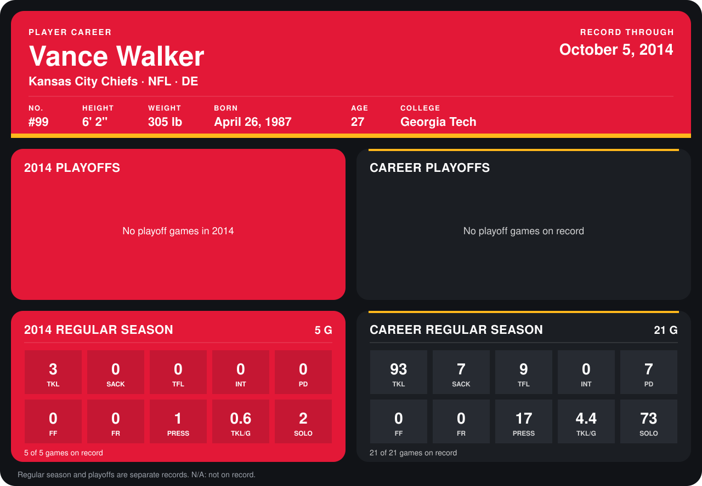

# Vance Walker

## Career stats

### Regular season

| Season | Club | G | TKL | SACK | TFL | INT | PD | FF | FR | PRESS | TKL/G | SOLO |
|---|---|---:|---:|---:|---:|---:|---:|---:|---:|---:|---:|---:|
| 2013 | Oakland Raiders | 16 | 90 | 7 | 9 | 0 | 7 | 0 | 0 | 16 | 5.6 | 71 |
| 2014 | Kansas City Chiefs | 4 | 2 | 0 | 0 | 0 | 0 | 0 | 0 | 1 | 0.5 | 1 |
| **Career** |  | 20 | 92 | 7 | 9 | 0 | 7 | 0 | 0 | 17 | 4.6 | 72 |

### Playoffs

No playoff games on record.

## Awards

- Pro Bowl selection (2013, DT)

Records through September 29, 2014. Identity: listed 2014 roster data, Weeks 1-4; number: 2014 Week 1 roster. [All Kansas City Chiefs players](README.md).
