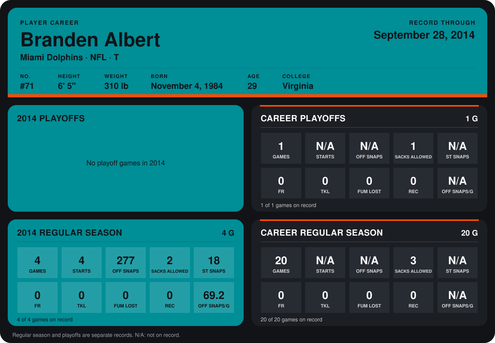

# Branden Albert

## Career stats

### Regular season

| Season | Club | G | STARTS | OFF SNAPS | SACKS ALLOWED | ST SNAPS | FR | TKL | FUM LOST | REC | OFF SNAPS/G |
|---|---|---:|---:|---:|---:|---:|---:|---:|---:|---:|---:|
| 2013 | Kansas City Chiefs | 16 | N/A | N/A | 1 | N/A | 0 | 0 | 0 | 0 | N/A |
| 2014 | Miami Dolphins | 4 | 4 | 277 | 2 | 18 | 0 | 0 | 0 | 0 | 69.2 |
| **Career** |  | 20 | N/A | N/A | 3 | N/A | 0 | 0 | 0 | 0 | N/A |

### Playoffs

| Season | Club | G | STARTS | OFF SNAPS | SACKS ALLOWED | ST SNAPS | FR | TKL | FUM LOST | REC | OFF SNAPS/G |
|---|---|---:|---:|---:|---:|---:|---:|---:|---:|---:|---:|
| 2013 | Kansas City Chiefs | 1 | N/A | N/A | 1 | N/A | 0 | 0 | 0 | 0 | N/A |
| **Career** |  | 1 | N/A | N/A | 1 | N/A | 0 | 0 | 0 | 0 | N/A |

## Awards

- AP First-Team All-Pro (2013, T)
- Pro Bowl selection (2013, T)

Records through September 29, 2014. Identity: listed 2014 roster data, Weeks 1-4; number: 2014 Week 1 roster. [All Miami Dolphins players](README.md).
