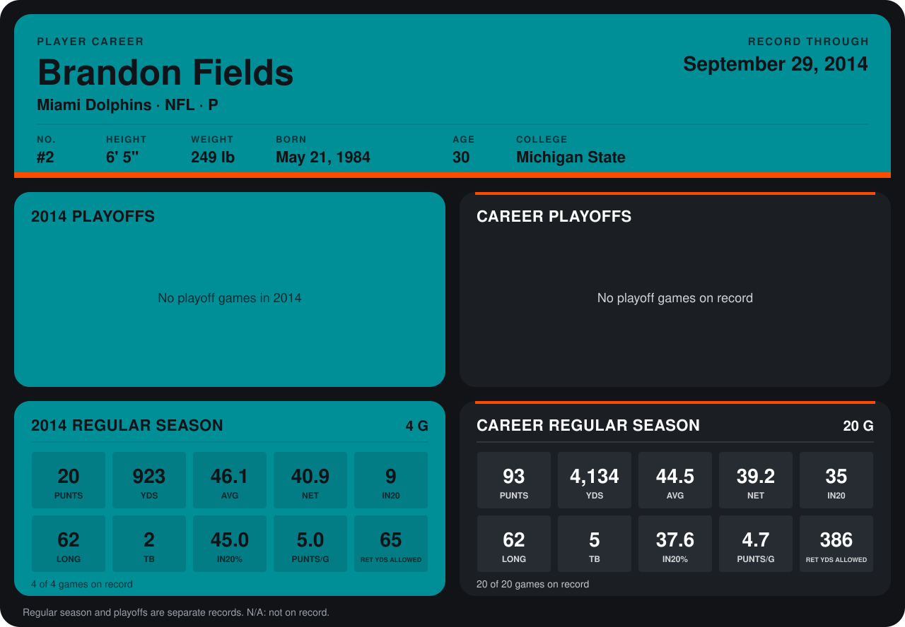

# Brandon Fields

## Career stats

### Regular season

| Season | Club | G | PUNTS | YDS | AVG | NET | IN20 | LONG | TB | IN20% | PUNTS/G | RET YDS ALLOWED |
|---|---|---:|---:|---:|---:|---:|---:|---:|---:|---:|---:|---:|
| 2013 | Miami Dolphins | 16 | 73 | 3,211 | 44.0 | 38.8 | 26 | 59 | 3 | 35.6 | 4.6 | 321 |
| 2014 | Miami Dolphins | 4 | 20 | 923 | 46.1 | 40.9 | 9 | 62 | 2 | 45.0 | 5.0 | 65 |
| **Career** |  | 20 | 93 | 4,134 | 44.5 | 39.2 | 35 | 62 | 5 | 37.6 | 4.7 | 386 |

### Playoffs

No playoff games on record.

## Awards

None on record.

Records through September 28, 2014. Identity: listed 2014 roster data, Weeks 1-4; number: 2014 Week 1 roster. [All Miami Dolphins players](README.md).
