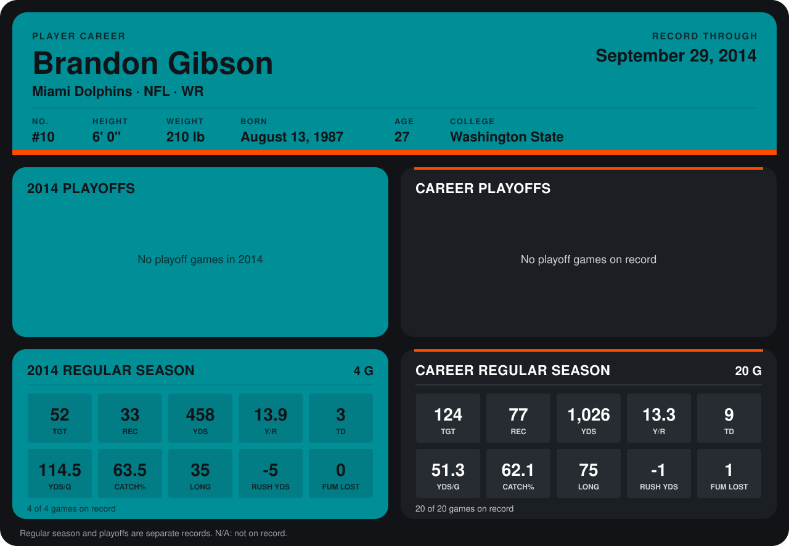

# Brandon Gibson

## Career stats

### Regular season

| Season | Team | Age | # | G | TGT | REC | YDS | Y/R | TD | YDS/G | CATCH% | LONG | RUSH YDS | FUM LOST |
|---|---|---:|---:|---:|---:|---:|---:|---:|---:|---:|---:|---:|---:|---:|
| 2013 | Miami Dolphins | 26 | 10 | 16 | 72 | 44 | 568 | 12.9 | 6 | 35.5 | 61.1 | 75 | 4 | 1 |
| 2014 | Miami Dolphins | 27 | 10 | 4 | 52 | 33 | 458 | 13.9 | 3 | 114.5 | 63.5 | 35 | -5 | 0 |
| **Career** |  |  |  | 20 | 124 | 77 | 1,026 | 13.3 | 9 | 51.3 | 62.1 | 75 | -1 | 1 |

### Playoffs

No playoff games on record.

## Awards

None on record.

Age is his age on the league's opening game of each season; # is the number listed for him that season with that team (2014: the card's rule; 2013: the 2013 season roster), N/A where no listing applies.

Records through September 28, 2014. Identity: listed 2014 roster data, Weeks 1-4; number: 2014 Week 1 roster. [All Miami Dolphins players](README.md).
