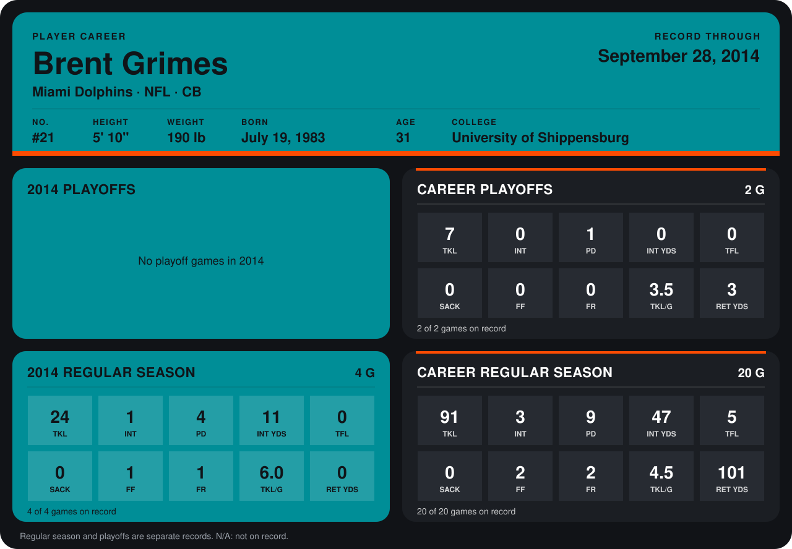

# Brent Grimes

## Career stats

### Regular season

| Season | Club | G | TKL | INT | PD | INT YDS | TFL | SACK | FF | FR | TKL/G | RET YDS |
|---|---|---:|---:|---:|---:|---:|---:|---:|---:|---:|---:|---:|
| 2013 | Jacksonville Jaguars | 16 | 67 | 2 | 5 | 36 | 5 | 0 | 1 | 1 | 4.2 | 101 |
| 2014 | Miami Dolphins | 4 | 24 | 1 | 4 | 11 | 0 | 0 | 1 | 1 | 6.0 | 0 |
| **Career** |  | 20 | 91 | 3 | 9 | 47 | 5 | 0 | 2 | 2 | 4.5 | 101 |

### Playoffs

| Season | Club | G | TKL | INT | PD | INT YDS | TFL | SACK | FF | FR | TKL/G | RET YDS |
|---|---|---:|---:|---:|---:|---:|---:|---:|---:|---:|---:|---:|
| 2013 | Jacksonville Jaguars | 2 | 7 | 0 | 1 | 0 | 0 | 0 | 0 | 0 | 3.5 | 3 |
| **Career** |  | 2 | 7 | 0 | 1 | 0 | 0 | 0 | 0 | 0 | 3.5 | 3 |

## Awards

None on record.

Records through September 28, 2014. Identity: listed 2014 roster data, Weeks 1-4; number: 2014 Week 1 roster. [All Miami Dolphins players](README.md).
