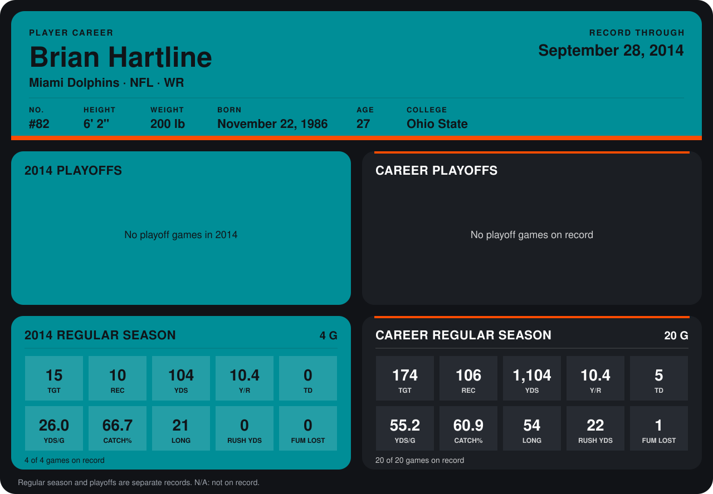

# Brian Hartline

## Career stats

### Regular season

| Season | Club | G | TGT | REC | YDS | Y/R | TD | YDS/G | CATCH% | LONG | RUSH YDS | FUM LOST |
|---|---|---:|---:|---:|---:|---:|---:|---:|---:|---:|---:|---:|
| 2013 | Miami Dolphins | 16 | 159 | 96 | 1,000 | 10.4 | 5 | 62.5 | 60.4 | 54 | 22 | 1 |
| 2014 | Miami Dolphins | 4 | 15 | 10 | 104 | 10.4 | 0 | 26.0 | 66.7 | 21 | 0 | 0 |
| **Career** |  | 20 | 174 | 106 | 1,104 | 10.4 | 5 | 55.2 | 60.9 | 54 | 22 | 1 |

### Playoffs

No playoff games on record.

## Awards

None on record.

Records through September 28, 2014. Identity: listed 2014 roster data, Weeks 1-4; number: 2014 Week 1 roster. [All Miami Dolphins players](README.md).
