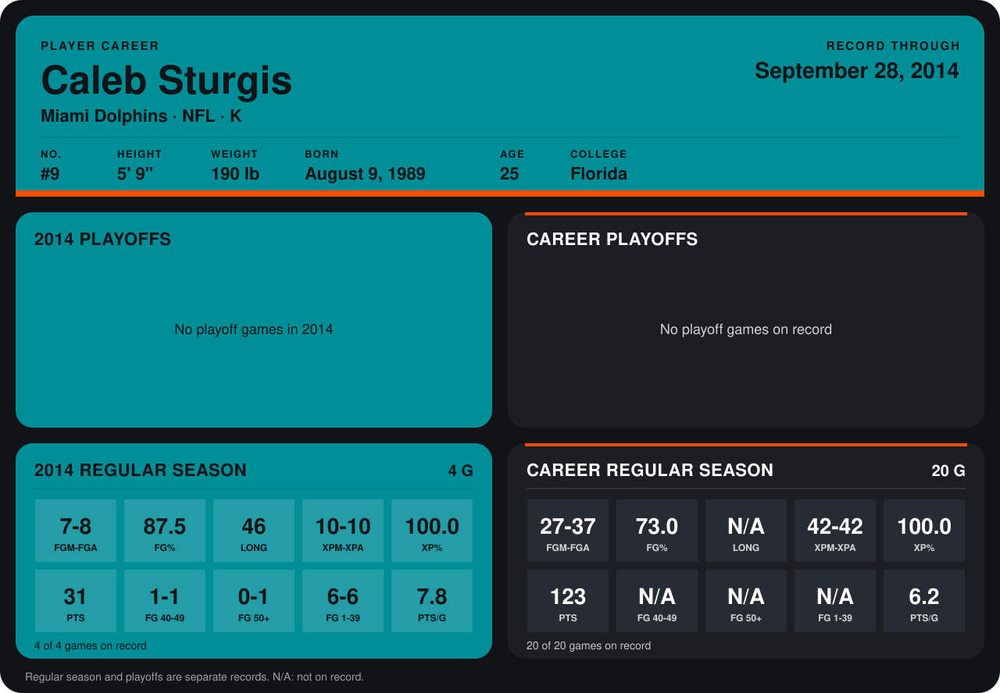

# Caleb Sturgis

## Career stats

### Regular season

| Season | Team | Age | # | G | FGM-FGA | FG% | LONG | XPM-XPA | XP% | PTS | FG 40-49 | FG 50+ | FG 1-39 | PTS/G |
|---|---|---:|---:|---:|---:|---:|---:|---:|---:|---:|---:|---:|---:|---:|
| 2013 | Miami Dolphins | 24 | 9 | 16 | 20-29 | 69.0 | N/A | 32-32 | 100.0 | 92 | N/A | N/A | N/A | 5.8 |
| 2014 | Miami Dolphins | 25 | 9 | 4 | 7-8 | 87.5 | 46 | 10-10 | 100.0 | 31 | 1-1 | 0-1 | 6-6 | 7.8 |
| **Career** |  |  |  | 20 | 27-37 | 73.0 | N/A | 42-42 | 100.0 | 123 | N/A | N/A | N/A | 6.2 |

### Playoffs

No playoff games on record.

## Awards

None on record.

Age is his age on the league's opening game of each season; # is the number listed for him that season with that team (2014: the card's rule; 2013: the 2013 season roster), N/A where no listing applies.

Records through September 28, 2014. Identity: listed 2014 roster data, Weeks 1-4; number: 2014 Week 1 roster. [All Miami Dolphins players](README.md).
