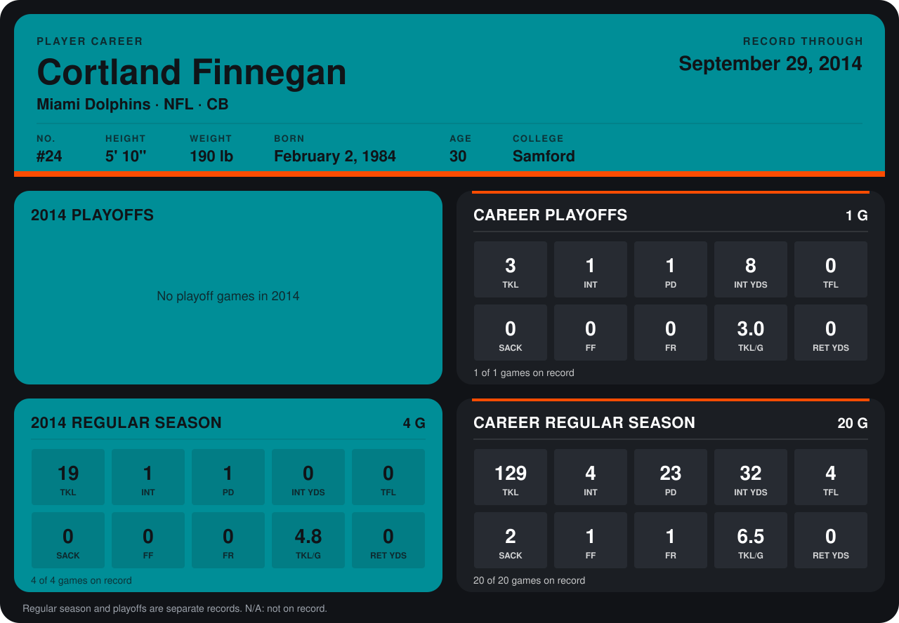

# Cortland Finnegan

## Career stats

### Regular season

| Season | Team | Age | # | G | TKL | INT | PD | INT YDS | TFL | SACK | FF | FR | TKL/G | RET YDS |
|---|---|---:|---:|---:|---:|---:|---:|---:|---:|---:|---:|---:|---:|---:|
| 2013 | St. Louis Rams | 29 | 31 | 16 | 110 | 3 | 22 | 32 | 4 | 2 | 1 | 1 | 6.9 | 0 |
| 2014 | Miami Dolphins | 30 | 24 | 4 | 19 | 1 | 1 | 0 | 0 | 0 | 0 | 0 | 4.8 | 0 |
| **Career** |  |  |  | 20 | 129 | 4 | 23 | 32 | 4 | 2 | 1 | 1 | 6.5 | 0 |

### Playoffs

| Season | Team | Age | # | G | TKL | INT | PD | INT YDS | TFL | SACK | FF | FR | TKL/G | RET YDS |
|---|---|---:|---:|---:|---:|---:|---:|---:|---:|---:|---:|---:|---:|---:|
| 2013 | St. Louis Rams | 29 | 31 | 1 | 3 | 1 | 1 | 8 | 0 | 0 | 0 | 0 | 3.0 | 0 |
| **Career** |  |  |  | 1 | 3 | 1 | 1 | 8 | 0 | 0 | 0 | 0 | 3.0 | 0 |

## Awards

- NFC Defensive Player of the Week (2013, Week 1)
- NFC Defensive Player of the Week (2013, Week 9)
- AP Second-Team All-Pro (2013, CB)
- Pro Bowl selection (2013, CB)

Age is his age on the league's opening game of each season; # is the number listed for him that season with that team (2014: the card's rule; 2013: the 2013 season roster), N/A where no listing applies.

Records through September 28, 2014. Identity: listed 2014 roster data, Weeks 1-4; number: 2014 Week 1 roster. [All Miami Dolphins players](README.md).
