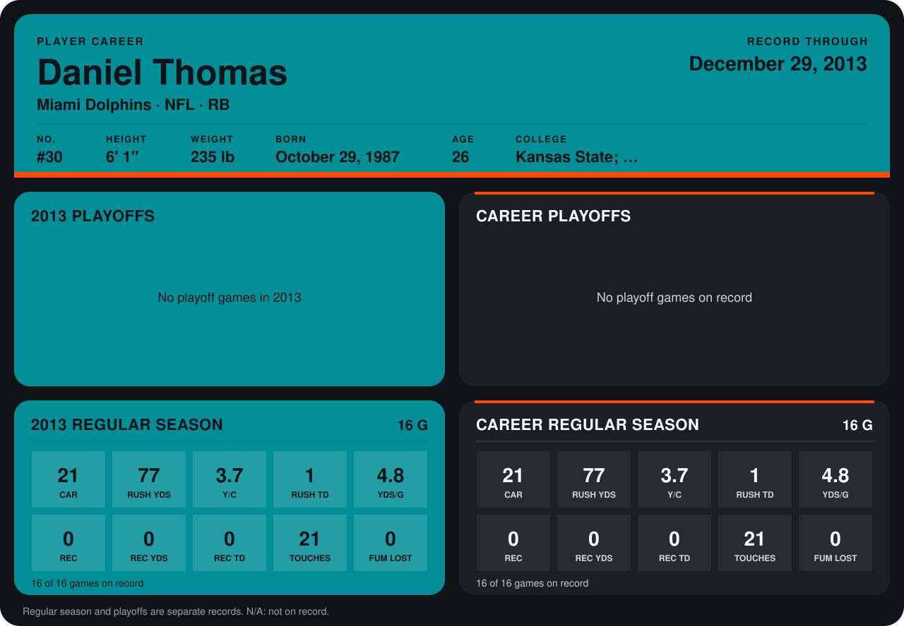

# Daniel Thomas

## Career stats

### Regular season

| Season | Club | G | CAR | RUSH YDS | Y/C | RUSH TD | YDS/G | REC | REC YDS | REC TD | TOUCHES | FUM LOST |
|---|---|---:|---:|---:|---:|---:|---:|---:|---:|---:|---:|---:|
| 2013 | Miami Dolphins | 16 | 21 | 77 | 3.7 | 1 | 4.8 | 0 | 0 | 0 | 21 | 0 |
| **Career** |  | 16 | 21 | 77 | 3.7 | 1 | 4.8 | 0 | 0 | 0 | 21 | 0 |

### Playoffs

No playoff games on record.

## Awards

None on record.

Schools listed: Kansas State; Manhattan Christian Coll. KS (J.C.); Butler County JC; Northwest Mississippi CC.

Records through December 29, 2013. Identity: listed 2014 roster data, Weeks 1-4; number: 2014 Week 4 roster listing. [All Miami Dolphins players](README.md).
