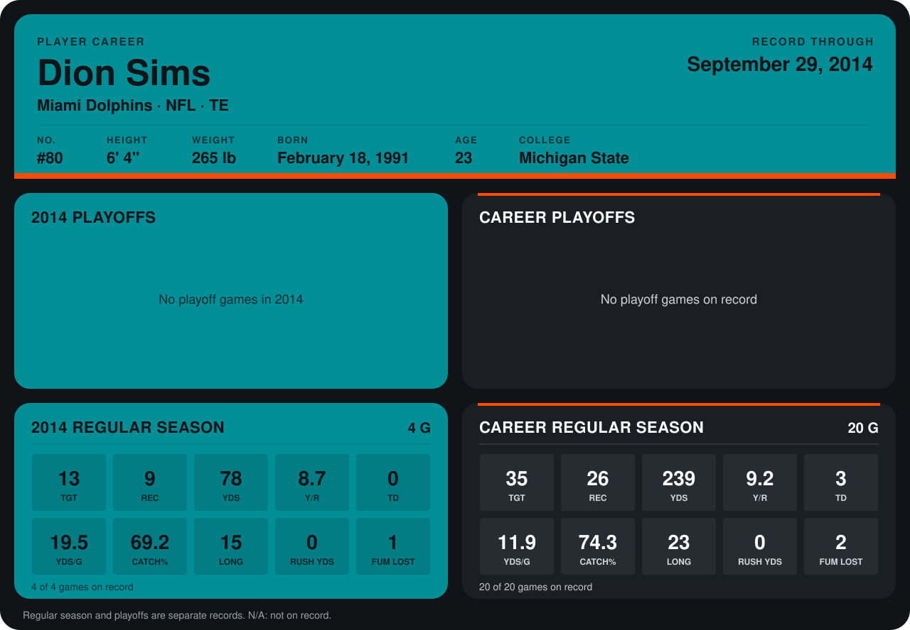

# Dion Sims

## Career stats

### Regular season

| Season | Team | Age | # | G | TGT | REC | YDS | Y/R | TD | YDS/G | CATCH% | LONG | RUSH YDS | FUM LOST |
|---|---|---:|---:|---:|---:|---:|---:|---:|---:|---:|---:|---:|---:|---:|
| 2013 | Miami Dolphins | 22 | 80 | 16 | 22 | 17 | 161 | 9.5 | 3 | 10.1 | 77.3 | 23 | 0 | 1 |
| 2014 | Miami Dolphins | 23 | 80 | 4 | 13 | 9 | 78 | 8.7 | 0 | 19.5 | 69.2 | 15 | 0 | 1 |
| **Career** |  |  |  | 20 | 35 | 26 | 239 | 9.2 | 3 | 11.9 | 74.3 | 23 | 0 | 2 |

### Playoffs

No playoff games on record.

## Awards

None on record.

Age is his age on the league's opening game of each season; # is the number listed for him that season with that team (2014: the card's rule; 2013: the 2013 season roster), N/A where no listing applies.

Records through September 28, 2014. Identity: listed 2014 roster data, Weeks 1-4; number: 2014 Week 1 roster. [All Miami Dolphins players](README.md).
