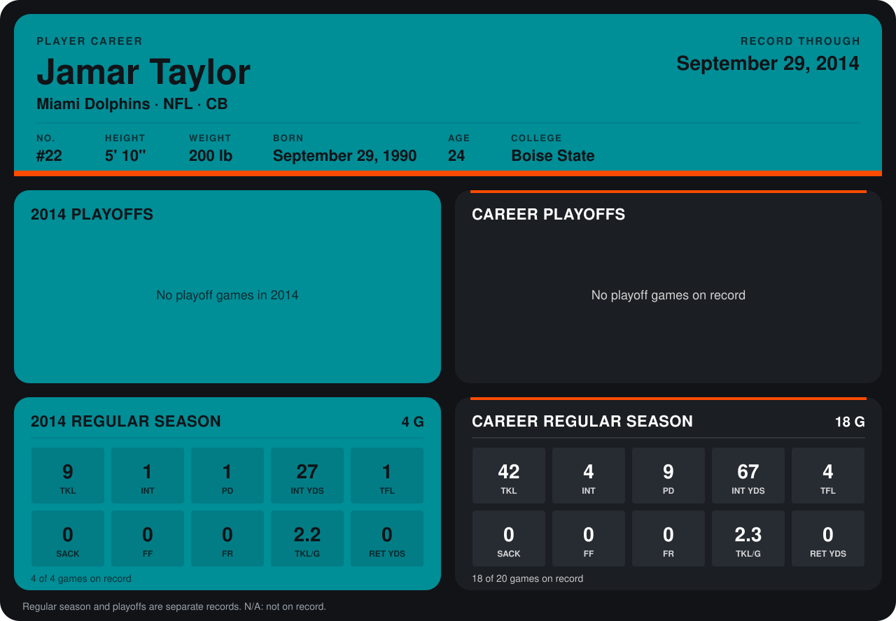

# Jamar Taylor

## Career stats

### Regular season

| Season | Club | G | TKL | INT | PD | INT YDS | TFL | SACK | FF | FR | TKL/G | RET YDS |
|---|---|---:|---:|---:|---:|---:|---:|---:|---:|---:|---:|---:|
| 2013 | Miami Dolphins | 14 | 33 | 3 | 8 | 40 | 3 | 0 | 0 | 0 | 2.4 | 0 |
| 2014 | Miami Dolphins | 4 | 9 | 1 | 1 | 27 | 1 | 0 | 0 | 0 | 2.2 | 0 |
| **Career** |  | 18 | 42 | 4 | 9 | 67 | 4 | 0 | 0 | 0 | 2.3 | 0 |

### Playoffs

No playoff games on record.

## Awards

None on record.

Records through September 28, 2014. Identity: listed 2014 roster data, Weeks 1-4; number: 2014 Week 1 roster. [All Miami Dolphins players](README.md).
