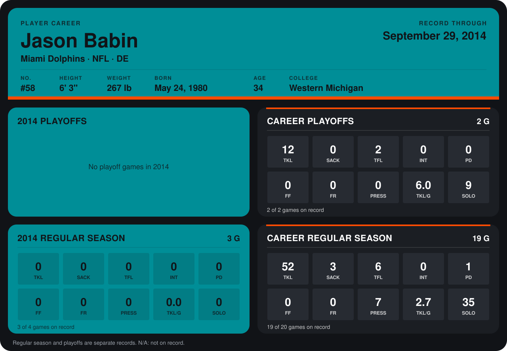

# Jason Babin

## Career stats

### Regular season

| Season | Club | G | TKL | SACK | TFL | INT | PD | FF | FR | PRESS | TKL/G | SOLO |
|---|---|---:|---:|---:|---:|---:|---:|---:|---:|---:|---:|---:|
| 2013 | Jacksonville Jaguars | 16 | 52 | 3 | 6 | 0 | 1 | 0 | 0 | 7 | 3.2 | 35 |
| 2014 | Miami Dolphins | 3 | 0 | 0 | 0 | 0 | 0 | 0 | 0 | 0 | 0.0 | 0 |
| **Career** |  | 19 | 52 | 3 | 6 | 0 | 1 | 0 | 0 | 7 | 2.7 | 35 |

### Playoffs

| Season | Club | G | TKL | SACK | TFL | INT | PD | FF | FR | PRESS | TKL/G | SOLO |
|---|---|---:|---:|---:|---:|---:|---:|---:|---:|---:|---:|---:|
| 2013 | Jacksonville Jaguars | 2 | 12 | 0 | 2 | 0 | 0 | 0 | 0 | 0 | 6.0 | 9 |
| **Career** |  | 2 | 12 | 0 | 2 | 0 | 0 | 0 | 0 | 0 | 6.0 | 9 |

## Awards

None on record.

Records through September 29, 2014. Identity: listed 2014 roster data, Weeks 1-4; number: 2014 Week 1 roster. [All Miami Dolphins players](README.md).
