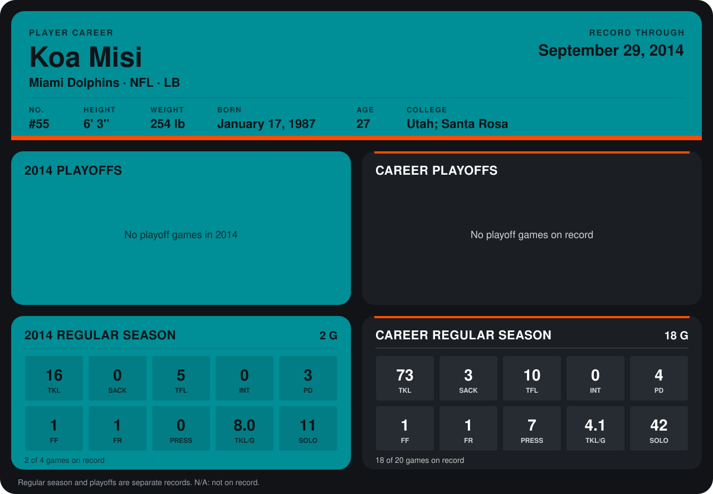

# Koa Misi

## Career stats

### Regular season

| Season | Club | G | TKL | SACK | TFL | INT | PD | FF | FR | PRESS | TKL/G | SOLO |
|---|---|---:|---:|---:|---:|---:|---:|---:|---:|---:|---:|---:|
| 2013 | Miami Dolphins | 16 | 57 | 3 | 5 | 0 | 1 | 0 | 0 | 7 | 3.6 | 31 |
| 2014 | Miami Dolphins | 2 | 16 | 0 | 5 | 0 | 3 | 1 | 1 | 0 | 8.0 | 11 |
| **Career** |  | 18 | 73 | 3 | 10 | 0 | 4 | 1 | 1 | 7 | 4.1 | 42 |

### Playoffs

No playoff games on record.

## Awards

None on record.

Records through September 29, 2014. Identity: listed 2014 roster data, Weeks 1-4; number: 2014 Week 1 roster. [All Miami Dolphins players](README.md).
