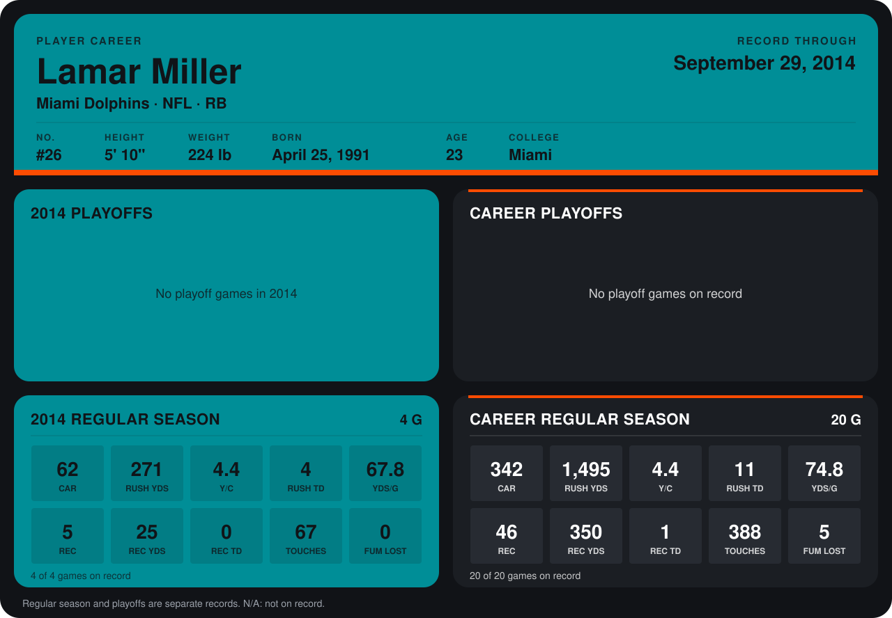

# Lamar Miller

## Career stats

### Regular season

| Season | Team | Age | # | G | CAR | RUSH YDS | Y/C | RUSH TD | YDS/G | REC | REC YDS | REC TD | TOUCHES | FUM LOST |
|---|---|---:|---:|---:|---:|---:|---:|---:|---:|---:|---:|---:|---:|---:|
| 2013 | Miami Dolphins | 22 | 26 | 16 | 280 | 1,224 | 4.4 | 7 | 76.5 | 41 | 325 | 1 | 321 | 5 |
| 2014 | Miami Dolphins | 23 | 26 | 4 | 62 | 271 | 4.4 | 4 | 67.8 | 5 | 25 | 0 | 67 | 0 |
| **Career** |  |  |  | 20 | 342 | 1,495 | 4.4 | 11 | 74.8 | 46 | 350 | 1 | 388 | 5 |

### Playoffs

No playoff games on record.

## Awards

None on record.

Age is his age on the league's opening game of each season; # is the number listed for him that season with that team (2014: the card's rule; 2013: the 2013 season roster), N/A where no listing applies.

Records through September 28, 2014. Identity: listed 2014 roster data, Weeks 1-4; number: 2014 Week 1 roster. [All Miami Dolphins players](README.md).
