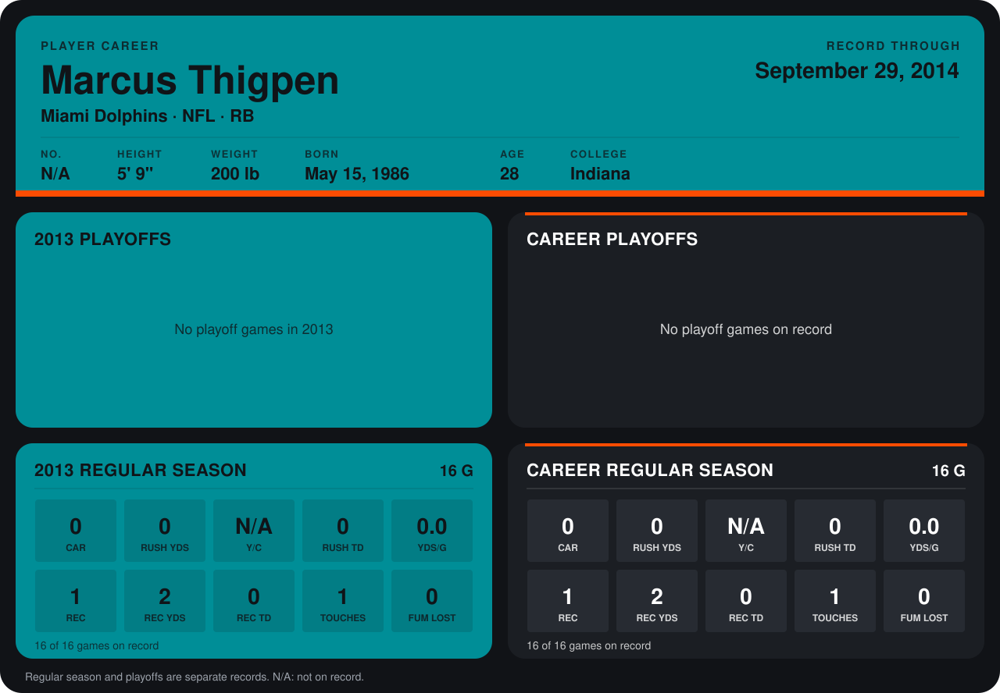

# Marcus Thigpen

## Career stats

### Regular season

| Season | Club | G | CAR | RUSH YDS | Y/C | RUSH TD | YDS/G | REC | REC YDS | REC TD | TOUCHES | FUM LOST |
|---|---|---:|---:|---:|---:|---:|---:|---:|---:|---:|---:|---:|
| 2013 | Miami Dolphins | 16 | 0 | 0 | N/A | 0 | 0.0 | 1 | 2 | 0 | 1 | 0 |
| **Career** |  | 16 | 0 | 0 | N/A | 0 | 0.0 | 1 | 2 | 0 | 1 | 0 |

### Playoffs

No playoff games on record.

## Awards

- AFC Special Teams Player of the Week (2013, Week 10)

Records through September 29, 2014. Identity: the public player file's latest listing (no 2014 Weeks 1-4 roster row). [All Miami Dolphins players](README.md).
