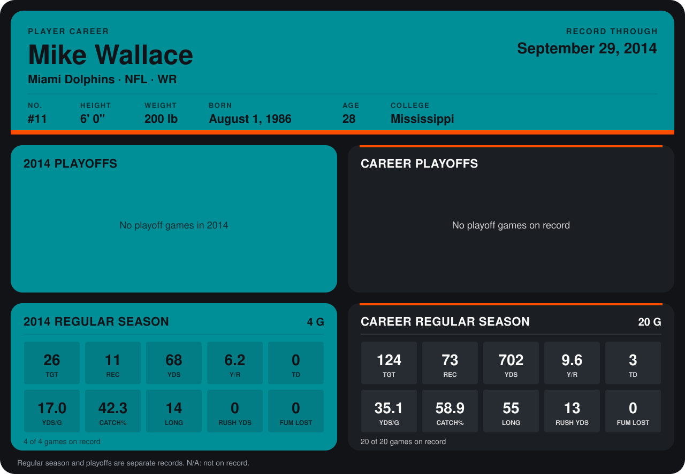

# Mike Wallace

## Career stats

### Regular season

| Season | Team | Age | # | G | TGT | REC | YDS | Y/R | TD | YDS/G | CATCH% | LONG | RUSH YDS | FUM LOST |
|---|---|---:|---:|---:|---:|---:|---:|---:|---:|---:|---:|---:|---:|---:|
| 2013 | Miami Dolphins | 27 | 11 | 16 | 98 | 62 | 634 | 10.2 | 3 | 39.6 | 63.3 | 55 | 13 | 0 |
| 2014 | Miami Dolphins | 28 | 11 | 4 | 26 | 11 | 68 | 6.2 | 0 | 17.0 | 42.3 | 14 | 0 | 0 |
| **Career** |  |  |  | 20 | 124 | 73 | 702 | 9.6 | 3 | 35.1 | 58.9 | 55 | 13 | 0 |

### Playoffs

No playoff games on record.

## Awards

None on record.

Age is his age on the league's opening game of each season; # is the number listed for him that season with that team (2014: the card's rule; 2013: the 2013 season roster), N/A where no listing applies.

Records through September 28, 2014. Identity: listed 2014 roster data, Weeks 1-4; number: 2014 Week 1 roster. [All Miami Dolphins players](README.md).
