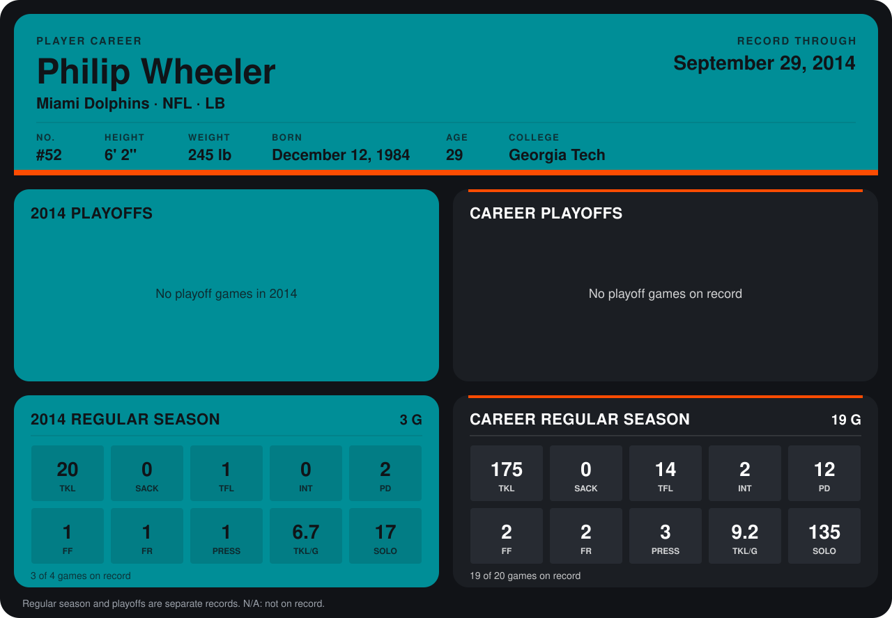

# Philip Wheeler

## Career stats

### Regular season

| Season | Club | G | TKL | SACK | TFL | INT | PD | FF | FR | PRESS | TKL/G | SOLO |
|---|---|---:|---:|---:|---:|---:|---:|---:|---:|---:|---:|---:|
| 2013 | Miami Dolphins | 16 | 155 | 0 | 13 | 2 | 10 | 1 | 1 | 2 | 9.7 | 118 |
| 2014 | Miami Dolphins | 3 | 20 | 0 | 1 | 0 | 2 | 1 | 1 | 1 | 6.7 | 17 |
| **Career** |  | 19 | 175 | 0 | 14 | 2 | 12 | 2 | 2 | 3 | 9.2 | 135 |

### Playoffs

No playoff games on record.

## Awards

None on record.

Records through September 28, 2014. Identity: listed 2014 roster data, Weeks 1-4; number: 2014 Week 1 roster. [All Miami Dolphins players](README.md).
