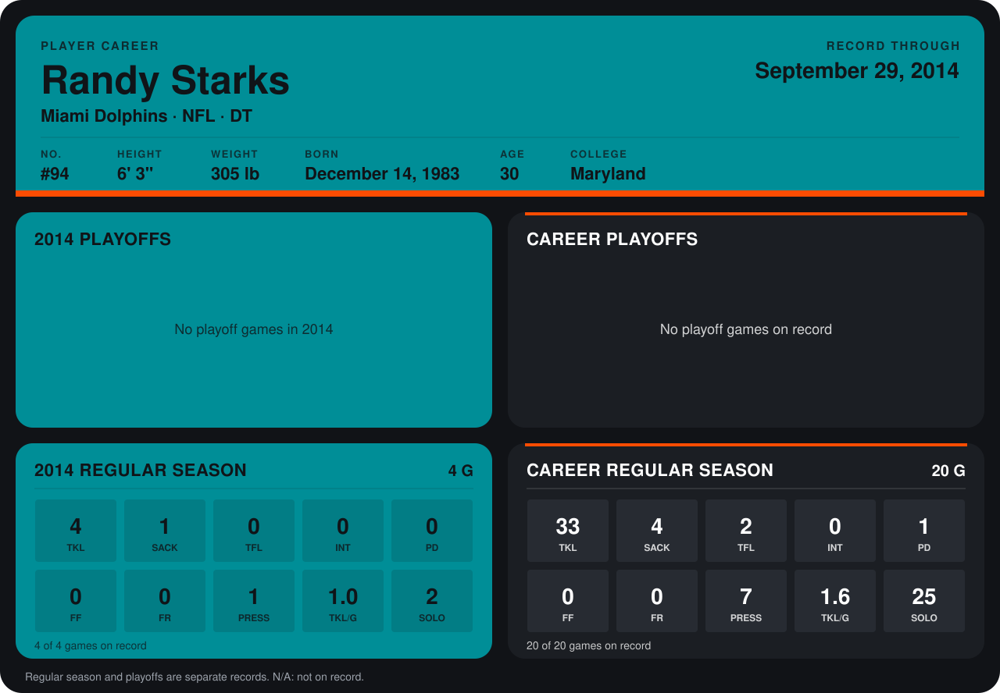

# Randy Starks

## Career stats

### Regular season

| Season | Club | G | TKL | SACK | TFL | INT | PD | FF | FR | PRESS | TKL/G | SOLO |
|---|---|---:|---:|---:|---:|---:|---:|---:|---:|---:|---:|---:|
| 2013 | Miami Dolphins | 16 | 29 | 3 | 2 | 0 | 1 | 0 | 0 | 6 | 1.8 | 23 |
| 2014 | Miami Dolphins | 4 | 4 | 1 | 0 | 0 | 0 | 0 | 0 | 1 | 1.0 | 2 |
| **Career** |  | 20 | 33 | 4 | 2 | 0 | 1 | 0 | 0 | 7 | 1.6 | 25 |

### Playoffs

No playoff games on record.

## Awards

None on record.

Records through September 29, 2014. Identity: listed 2014 roster data, Weeks 1-4; number: 2014 Week 1 roster. [All Miami Dolphins players](README.md).
