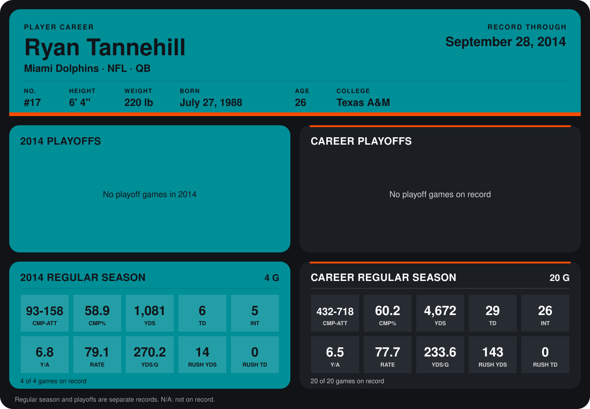

# Ryan Tannehill

## Career stats

### Regular season

| Season | Club | G | CMP-ATT | CMP% | YDS | TD | INT | Y/A | RATE | YDS/G | RUSH YDS | RUSH TD |
|---|---|---:|---:|---:|---:|---:|---:|---:|---:|---:|---:|---:|
| 2013 | Miami Dolphins | 16 | 339-560 | 60.5 | 3,591 | 23 | 21 | 6.4 | 77.3 | 224.4 | 129 | 0 |
| 2014 | Miami Dolphins | 4 | 93-158 | 58.9 | 1,081 | 6 | 5 | 6.8 | 79.1 | 270.2 | 14 | 0 |
| **Career** |  | 20 | 432-718 | 60.2 | 4,672 | 29 | 26 | 6.5 | 77.7 | 233.6 | 143 | 0 |

### Playoffs

No playoff games on record.

## Awards

None on record.

Records through September 28, 2014. Identity: listed 2014 roster data, Weeks 1-4; number: 2014 Week 1 roster. [All Miami Dolphins players](README.md).
