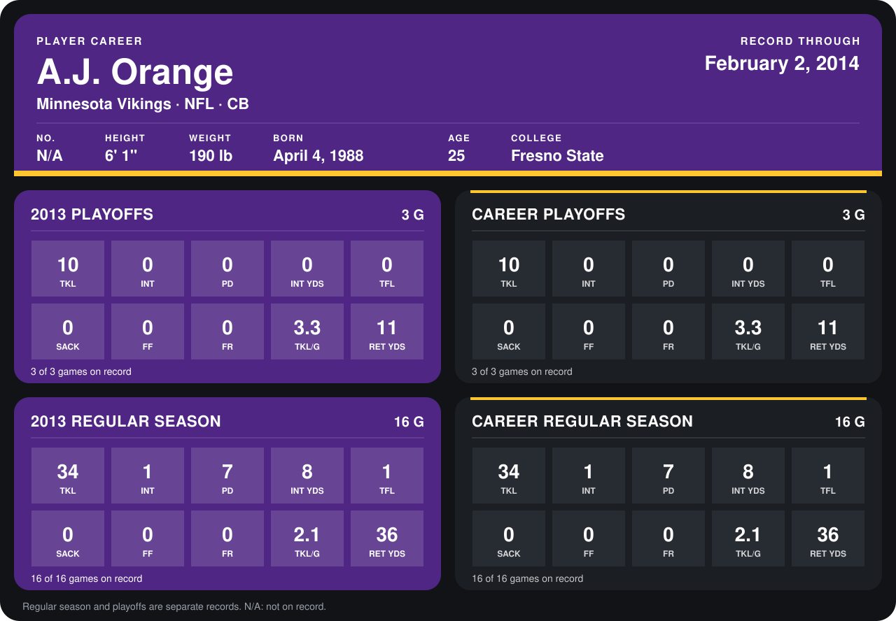

# A.J. Orange

## Career stats

### Regular season

| Season | Club | G | TKL | INT | PD | INT YDS | TFL | SACK | FF | FR | TKL/G | RET YDS |
|---|---|---:|---:|---:|---:|---:|---:|---:|---:|---:|---:|---:|
| 2013 | Minnesota Vikings | 16 | 34 | 1 | 7 | 8 | 1 | 0 | 0 | 0 | 2.1 | 36 |
| **Career** |  | 16 | 34 | 1 | 7 | 8 | 1 | 0 | 0 | 0 | 2.1 | 36 |

### Playoffs

| Season | Club | G | TKL | INT | PD | INT YDS | TFL | SACK | FF | FR | TKL/G | RET YDS |
|---|---|---:|---:|---:|---:|---:|---:|---:|---:|---:|---:|---:|
| 2013 | Minnesota Vikings | 3 | 10 | 0 | 0 | 0 | 0 | 0 | 0 | 0 | 3.3 | 11 |
| **Career** |  | 3 | 10 | 0 | 0 | 0 | 0 | 0 | 0 | 0 | 3.3 | 11 |

## Awards

None on record.

Records through September 29, 2014. Identity: the public player file's latest listing (no 2014 Weeks 1-4 roster row). [All Minnesota Vikings players](README.md).
