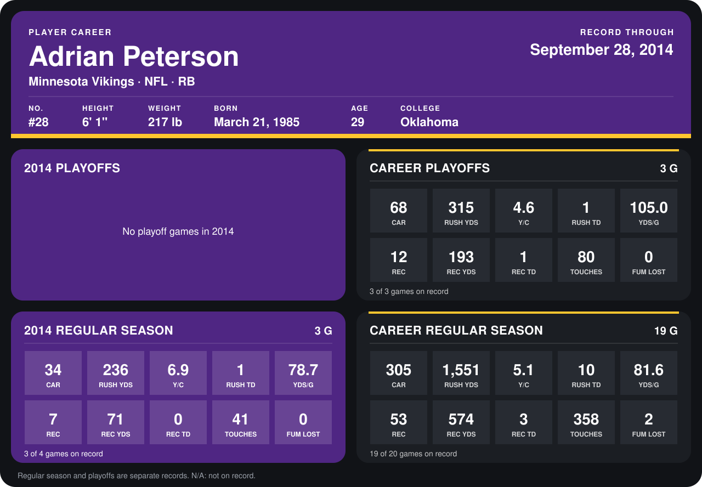

# Adrian Peterson

## Career stats

### Regular season

| Season | Team | Age | # | G | CAR | RUSH YDS | Y/C | RUSH TD | YDS/G | REC | REC YDS | REC TD | TOUCHES | FUM LOST |
|---|---|---:|---:|---:|---:|---:|---:|---:|---:|---:|---:|---:|---:|---:|
| 2013 | Minnesota Vikings | 28 | 28 | 16 | 271 | 1,315 | 4.9 | 9 | 82.2 | 46 | 503 | 3 | 317 | 2 |
| 2014 | Minnesota Vikings | 29 | 28 | 3 | 34 | 236 | 6.9 | 1 | 78.7 | 7 | 71 | 0 | 41 | 0 |
| **Career** |  |  |  | 19 | 305 | 1,551 | 5.1 | 10 | 81.6 | 53 | 574 | 3 | 358 | 2 |

### Playoffs

| Season | Team | Age | # | G | CAR | RUSH YDS | Y/C | RUSH TD | YDS/G | REC | REC YDS | REC TD | TOUCHES | FUM LOST |
|---|---|---:|---:|---:|---:|---:|---:|---:|---:|---:|---:|---:|---:|---:|
| 2013 | Minnesota Vikings | 28 | 28 | 3 | 68 | 315 | 4.6 | 1 | 105.0 | 12 | 193 | 1 | 80 | 0 |
| **Career** |  |  |  | 3 | 68 | 315 | 4.6 | 1 | 105.0 | 12 | 193 | 1 | 80 | 0 |

## Awards

- NFC Offensive Player of the Week (2013, Week 9)

Age is his age on the league's opening game of each season; # is the number listed for him that season with that team (2014: the card's rule; 2013: the 2013 season roster), N/A where no listing applies.

Records through September 28, 2014. Identity: listed 2014 roster data, Weeks 1-4; number: 2014 Week 1 roster. [All Minnesota Vikings players](README.md).
