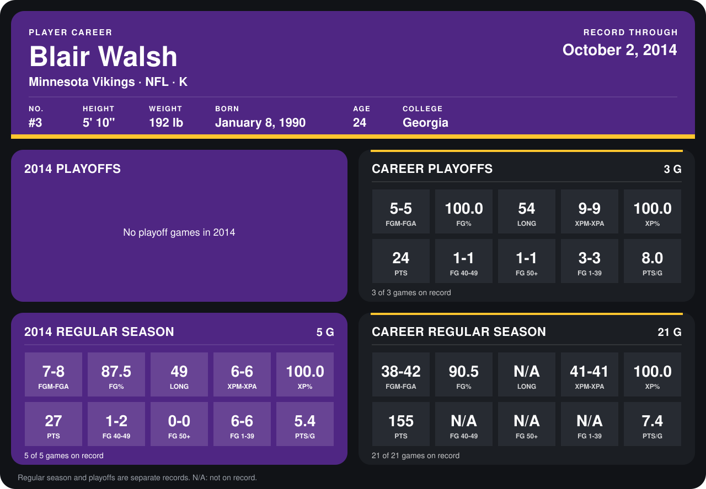

# Blair Walsh

## Career stats

### Regular season

| Season | Team | Age | # | G | FGM-FGA | FG% | LONG | XPM-XPA | XP% | PTS | FG 40-49 | FG 50+ | FG 1-39 | PTS/G |
|---|---|---:|---:|---:|---:|---:|---:|---:|---:|---:|---:|---:|---:|---:|
| 2013 | Minnesota Vikings | 23 | 3 | 16 | 31-34 | 91.2 | N/A | 35-35 | 100.0 | 128 | N/A | N/A | N/A | 8.0 |
| 2014 | Minnesota Vikings | 24 | 3 | 4 | 5-6 | 83.3 | 39 | 6-6 | 100.0 | 21 | 0-1 | 0-0 | 5-5 | 5.2 |
| **Career** |  |  |  | 20 | 36-40 | 90.0 | N/A | 41-41 | 100.0 | 149 | N/A | N/A | N/A | 7.5 |

### Playoffs

| Season | Team | Age | # | G | FGM-FGA | FG% | LONG | XPM-XPA | XP% | PTS | FG 40-49 | FG 50+ | FG 1-39 | PTS/G |
|---|---|---:|---:|---:|---:|---:|---:|---:|---:|---:|---:|---:|---:|---:|
| 2013 | Minnesota Vikings | 23 | 3 | 3 | 5-5 | 100.0 | 54 | 9-9 | 100.0 | 24 | 1-1 | 1-1 | 3-3 | 8.0 |
| **Career** |  |  |  | 3 | 5-5 | 100.0 | 54 | 9-9 | 100.0 | 24 | 1-1 | 1-1 | 3-3 | 8.0 |

## Awards

None on record.

Age is his age on the league's opening game of each season; # is the number listed for him that season with that team (2014: the card's rule; 2013: the 2013 season roster), N/A where no listing applies.

Records through September 28, 2014. Identity: listed 2014 roster data, Weeks 1-4; number: 2014 Week 1 roster. [All Minnesota Vikings players](README.md).
