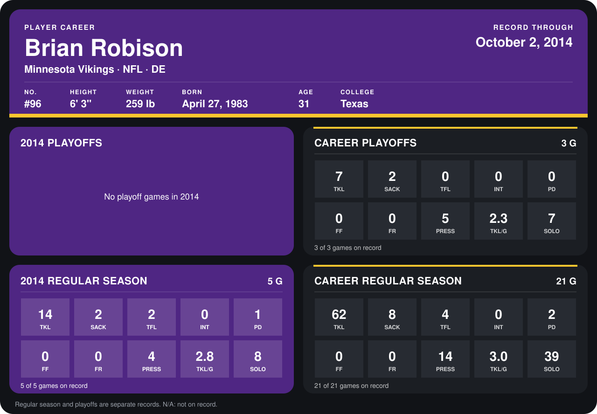

# Brian Robison

## Career stats

### Regular season

| Season | Team | Age | # | G | TKL | SACK | TFL | INT | PD | FF | FR | PRESS | TKL/G | SOLO |
|---|---|---:|---:|---:|---:|---:|---:|---:|---:|---:|---:|---:|---:|---:|
| 2013 | Minnesota Vikings | 30 | 96 | 16 | 48 | 6 | 2 | 0 | 1 | 0 | 0 | 10 | 3.0 | 31 |
| 2014 | Minnesota Vikings | 31 | 96 | 5 | 14 | 2 | 2 | 0 | 1 | 0 | 0 | 4 | 2.8 | 8 |
| **Career** |  |  |  | 21 | 62 | 8 | 4 | 0 | 2 | 0 | 0 | 14 | 3.0 | 39 |

### Playoffs

| Season | Team | Age | # | G | TKL | SACK | TFL | INT | PD | FF | FR | PRESS | TKL/G | SOLO |
|---|---|---:|---:|---:|---:|---:|---:|---:|---:|---:|---:|---:|---:|---:|
| 2013 | Minnesota Vikings | 30 | 96 | 3 | 7 | 2 | 0 | 0 | 0 | 0 | 0 | 5 | 2.3 | 7 |
| **Career** |  |  |  | 3 | 7 | 2 | 0 | 0 | 0 | 0 | 0 | 5 | 2.3 | 7 |

## Awards

None on record.

Age is his age on the league's opening game of each season; # is the number listed for him that season with that team (2014: the card's rule; 2013: the 2013 season roster), N/A where no listing applies.

Records through October 2, 2014. Identity: listed 2014 roster data, Weeks 1-4; number: 2014 Week 1 roster. [All Minnesota Vikings players](README.md).
