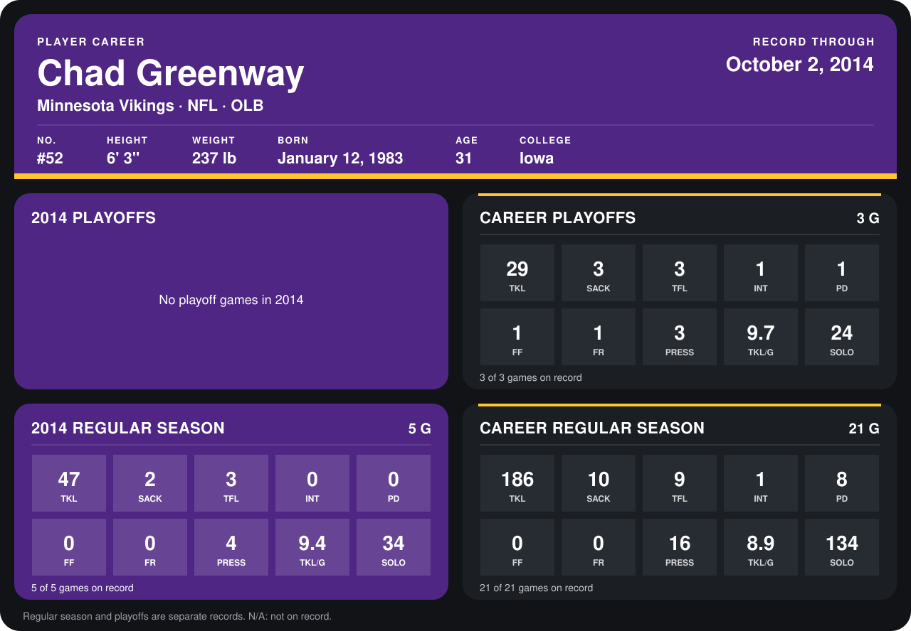

# Chad Greenway

## Career stats

### Regular season

| Season | Club | G | TKL | SACK | TFL | INT | PD | FF | FR | PRESS | TKL/G | SOLO |
|---|---|---:|---:|---:|---:|---:|---:|---:|---:|---:|---:|---:|
| 2013 | Minnesota Vikings | 16 | 139 | 8 | 6 | 1 | 8 | 0 | 0 | 12 | 8.7 | 100 |
| 2014 | Minnesota Vikings | 5 | 47 | 2 | 3 | 0 | 0 | 0 | 0 | 4 | 9.4 | 34 |
| **Career** |  | 21 | 186 | 10 | 9 | 1 | 8 | 0 | 0 | 16 | 8.9 | 134 |

### Playoffs

| Season | Club | G | TKL | SACK | TFL | INT | PD | FF | FR | PRESS | TKL/G | SOLO |
|---|---|---:|---:|---:|---:|---:|---:|---:|---:|---:|---:|---:|
| 2013 | Minnesota Vikings | 3 | 29 | 3 | 3 | 1 | 1 | 1 | 1 | 3 | 9.7 | 24 |
| **Career** |  | 3 | 29 | 3 | 3 | 1 | 1 | 1 | 1 | 3 | 9.7 | 24 |

## Awards

- Pro Bowl selection (2013, OLB)

Records through October 2, 2014. Identity: listed 2014 roster data, Weeks 1-4; number: 2014 Week 1 roster. [All Minnesota Vikings players](README.md).
