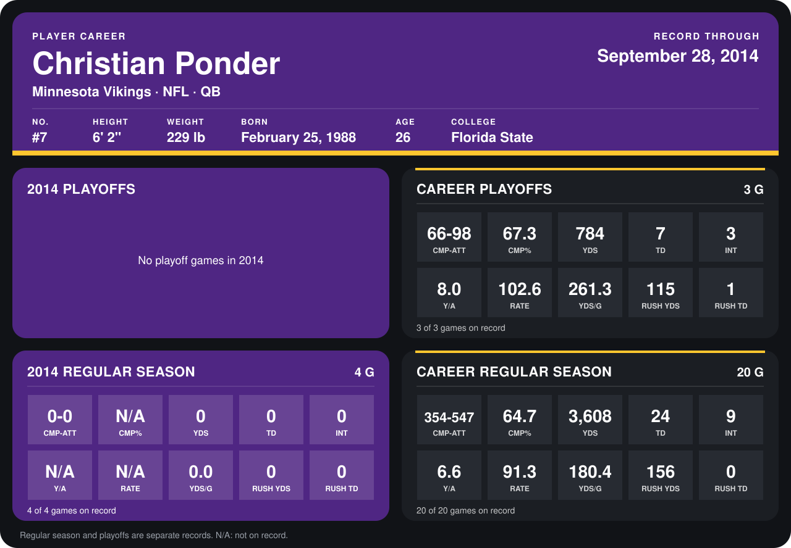

# Christian Ponder

## Career stats

### Regular season

| Season | Team | Age | # | G | CMP-ATT | CMP% | YDS | TD | INT | Y/A | RATE | YDS/G | RUSH YDS | RUSH TD |
|---|---|---:|---:|---:|---:|---:|---:|---:|---:|---:|---:|---:|---:|---:|
| 2013 | Minnesota Vikings | 25 | 7 | 16 | 354-547 | 64.7 | 3,608 | 24 | 9 | 6.6 | 91.3 | 225.5 | 156 | 0 |
| 2014 | Minnesota Vikings | 26 | 7 | 5 | 0-0 | N/A | 0 | 0 | 0 | N/A | N/A | 0.0 | 0 | 0 |
| **Career** |  |  |  | 21 | 354-547 | 64.7 | 3,608 | 24 | 9 | 6.6 | 91.3 | 171.8 | 156 | 0 |

### Playoffs

| Season | Team | Age | # | G | CMP-ATT | CMP% | YDS | TD | INT | Y/A | RATE | YDS/G | RUSH YDS | RUSH TD |
|---|---|---:|---:|---:|---:|---:|---:|---:|---:|---:|---:|---:|---:|---:|
| 2013 | Minnesota Vikings | 25 | 7 | 3 | 66-98 | 67.3 | 784 | 7 | 3 | 8.0 | 102.6 | 261.3 | 115 | 1 |
| **Career** |  |  |  | 3 | 66-98 | 67.3 | 784 | 7 | 3 | 8.0 | 102.6 | 261.3 | 115 | 1 |

## Awards

None on record.

Age is his age on the league's opening game of each season; # is the number listed for him that season with that team (2014: the card's rule; 2013: the 2013 season roster), N/A where no listing applies.

Records through October 2, 2014. Identity: listed 2014 roster data, Weeks 1-4; number: 2014 Week 1 roster. [All Minnesota Vikings players](README.md).
