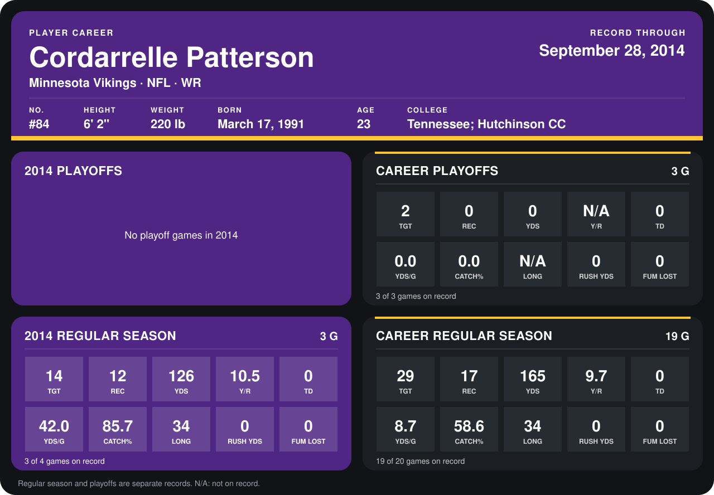

# Cordarrelle Patterson

## Career stats

### Regular season

| Season | Team | Age | # | G | TGT | REC | YDS | Y/R | TD | YDS/G | CATCH% | LONG | RUSH YDS | FUM LOST |
|---|---|---:|---:|---:|---:|---:|---:|---:|---:|---:|---:|---:|---:|---:|
| 2013 | Minnesota Vikings | 22 | 84 | 16 | 15 | 5 | 39 | 7.8 | 0 | 2.4 | 33.3 | 20 | 0 | 0 |
| 2014 | Minnesota Vikings | 23 | 84 | 3 | 14 | 12 | 126 | 10.5 | 0 | 42.0 | 85.7 | 34 | 0 | 0 |
| **Career** |  |  |  | 19 | 29 | 17 | 165 | 9.7 | 0 | 8.7 | 58.6 | 34 | 0 | 0 |

### Playoffs

| Season | Team | Age | # | G | TGT | REC | YDS | Y/R | TD | YDS/G | CATCH% | LONG | RUSH YDS | FUM LOST |
|---|---|---:|---:|---:|---:|---:|---:|---:|---:|---:|---:|---:|---:|---:|
| 2013 | Minnesota Vikings | 22 | 84 | 3 | 2 | 0 | 0 | N/A | 0 | 0.0 | 0.0 | N/A | 0 | 0 |
| **Career** |  |  |  | 3 | 2 | 0 | 0 | N/A | 0 | 0.0 | 0.0 | N/A | 0 | 0 |

## Awards

None on record.

Age is his age on the league's opening game of each season; # is the number listed for him that season with that team (2014: the card's rule; 2013: the 2013 season roster), N/A where no listing applies.

Records through September 28, 2014. Identity: listed 2014 roster data, Weeks 1-4; number: 2014 Week 1 roster. [All Minnesota Vikings players](README.md).
