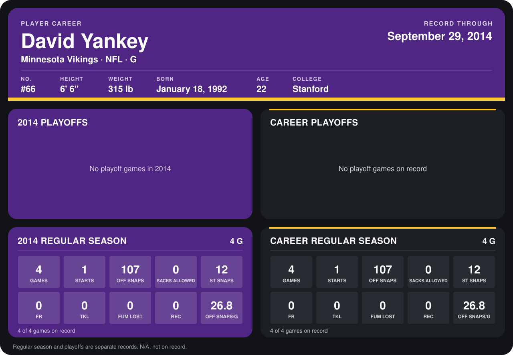

# David Yankey

## Career stats

### Regular season

| Season | Club | G | STARTS | OFF SNAPS | SACKS ALLOWED | ST SNAPS | FR | TKL | FUM LOST | REC | OFF SNAPS/G |
|---|---|---:|---:|---:|---:|---:|---:|---:|---:|---:|---:|
| 2014 | Minnesota Vikings | 4 | 1 | 107 | 0 | 12 | 0 | 0 | 0 | 0 | 26.8 |
| **Career** |  | 4 | 1 | 107 | 0 | 12 | 0 | 0 | 0 | 0 | 26.8 |

### Playoffs

No playoff games on record.

## Awards

None on record.

Records through September 29, 2014. Identity: listed 2014 roster data, Weeks 1-4; number: 2014 Week 1 roster. [All Minnesota Vikings players](README.md).
