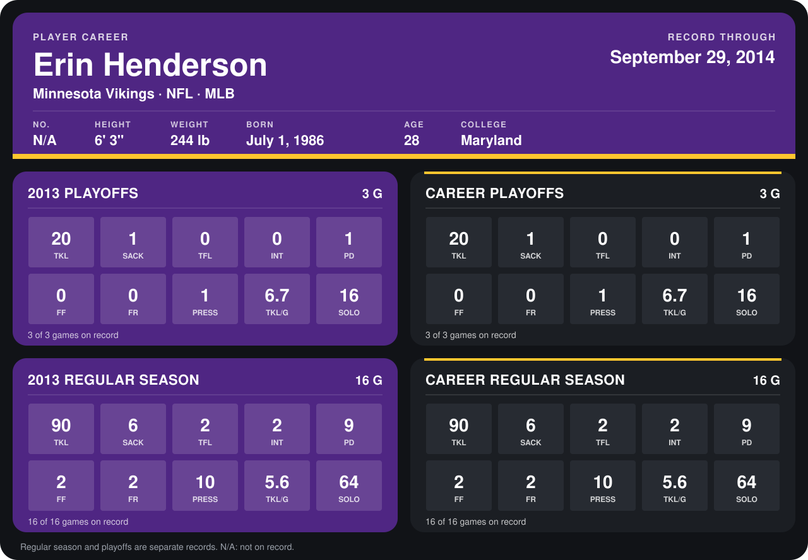

# Erin Henderson

## Career stats

### Regular season

| Season | Club | G | TKL | SACK | TFL | INT | PD | FF | FR | PRESS | TKL/G | SOLO |
|---|---|---:|---:|---:|---:|---:|---:|---:|---:|---:|---:|---:|
| 2013 | Minnesota Vikings | 16 | 90 | 6 | 2 | 2 | 9 | 2 | 2 | 10 | 5.6 | 64 |
| **Career** |  | 16 | 90 | 6 | 2 | 2 | 9 | 2 | 2 | 10 | 5.6 | 64 |

### Playoffs

| Season | Club | G | TKL | SACK | TFL | INT | PD | FF | FR | PRESS | TKL/G | SOLO |
|---|---|---:|---:|---:|---:|---:|---:|---:|---:|---:|---:|---:|
| 2013 | Minnesota Vikings | 3 | 20 | 1 | 0 | 0 | 1 | 0 | 0 | 1 | 6.7 | 16 |
| **Career** |  | 3 | 20 | 1 | 0 | 0 | 1 | 0 | 0 | 1 | 6.7 | 16 |

## Awards

None on record.

Records through September 29, 2014. Identity: the public player file's latest listing (no 2014 Weeks 1-4 roster row). [All Minnesota Vikings players](README.md).
